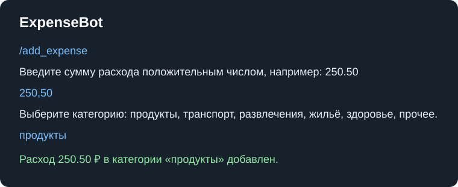

# ExpenseBot

Telegram-бот для учёта личных расходов по категориям. Работа выполнена для лабораторной №3: команды с последовательным вводом реализованы как конечный автомат, а состояние изолировано для каждого чата.

## Возможности

- `/add_expense` — пошагово запрашивает сумму и категорию, затем сохраняет расход;
- `/expenses` — показывает сохранённые расходы с номерами;
- `/delete_expense <номер>` — удаляет сохранённый расход по его номеру;
- `/categories` — показывает доступные категории и потраченные в них суммы за текущий месяц;
- `/add_category` — добавляет собственную категорию;
- `/report` — выводит общую сумму, разбивку с долями и топ-3 категорий;
- `/cancel` — отменяет незавершённый пошаговый ввод.

Стандартные категории: продукты, транспорт, развлечения, жильё, здоровье, прочее.

## Запуск

1. Установите зависимости: `npm install`.
2. Скопируйте `.env.example` в `.env` и укажите токен бота:

   ```env
   TELEGRAM_BOT_TOKEN=ваш_токен_бота
   ```

3. Запустите приложение: `npm start`.

Проверки:

```sh
npm run lint
npm run test:coverage
```

Токен не должен попадать в репозиторий: `.env` уже добавлен в `.gitignore`.

## Примеры работы




