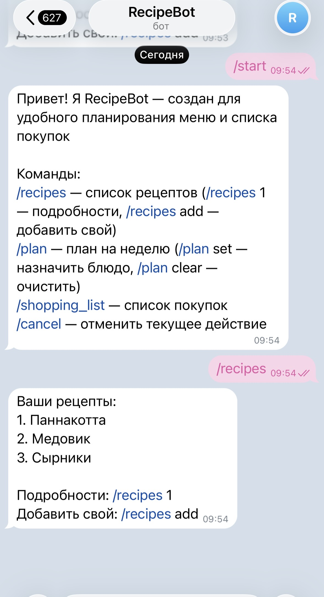
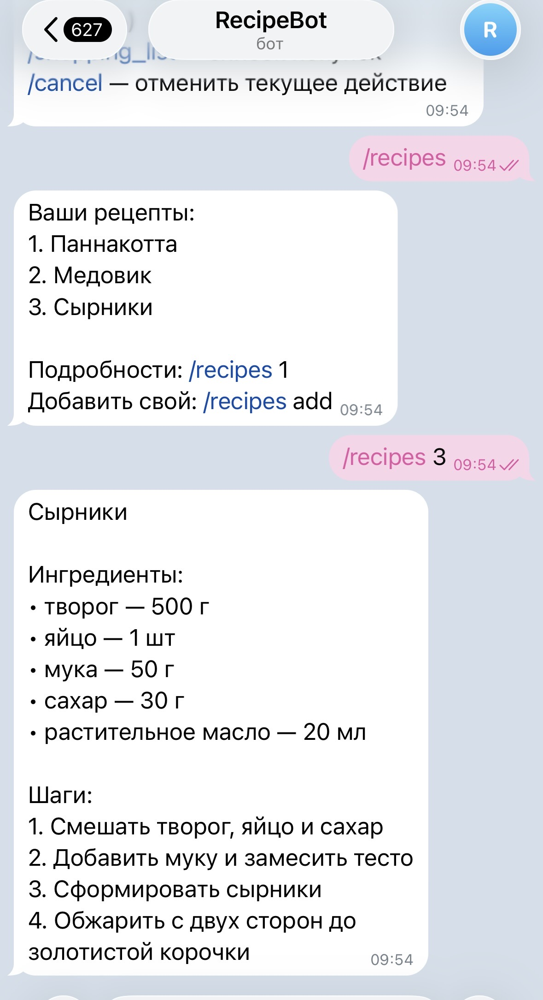
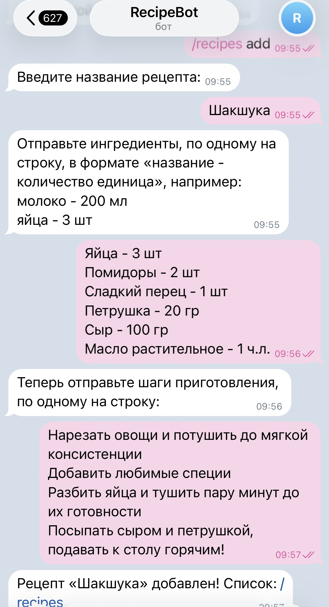
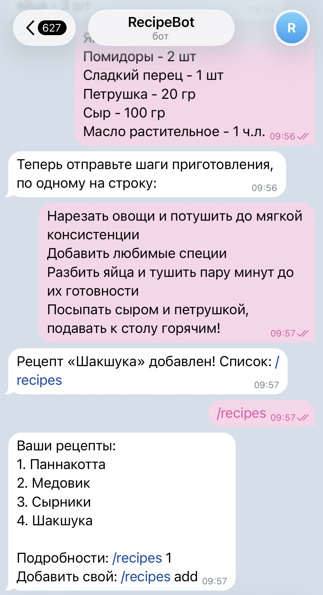
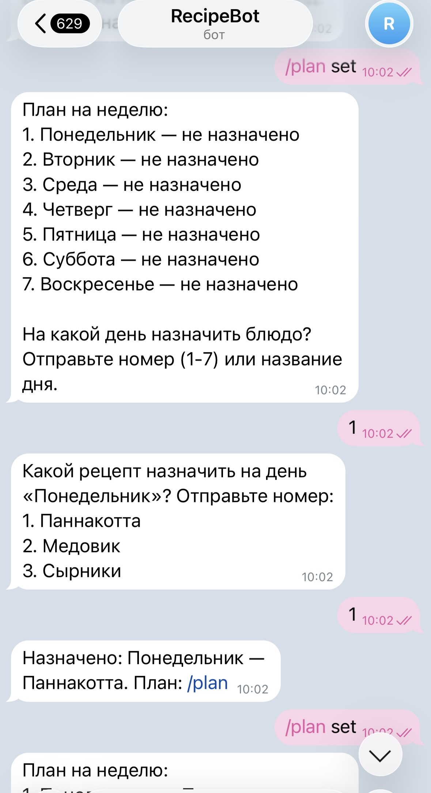
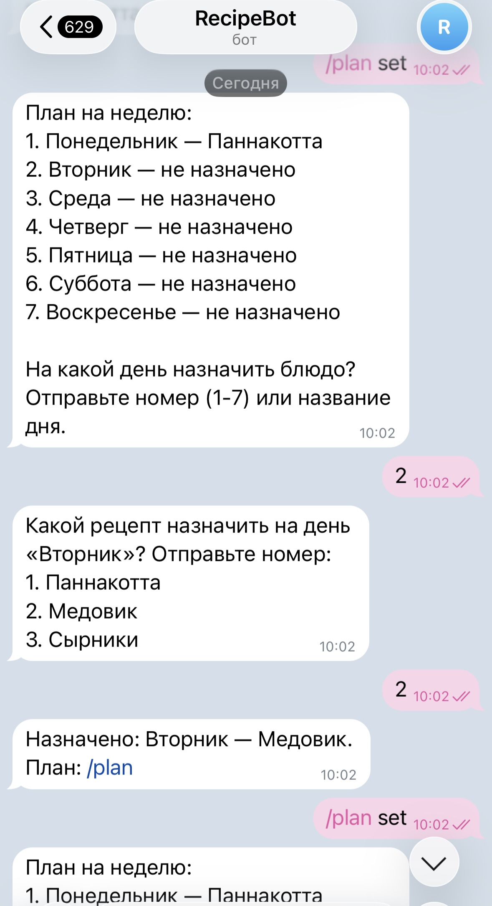
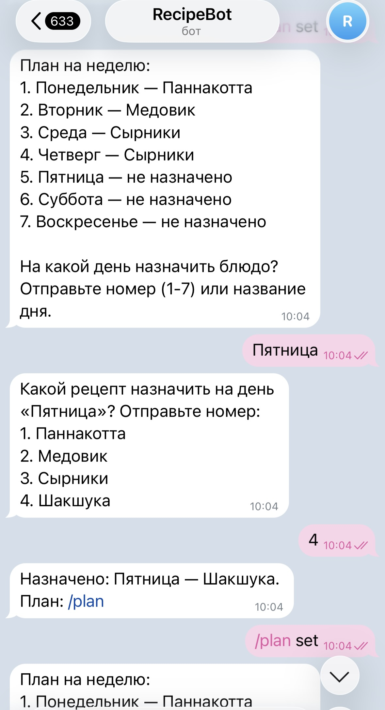
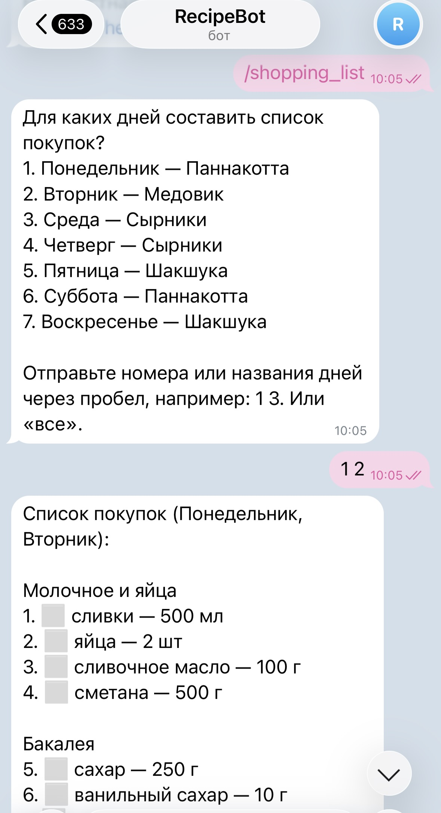
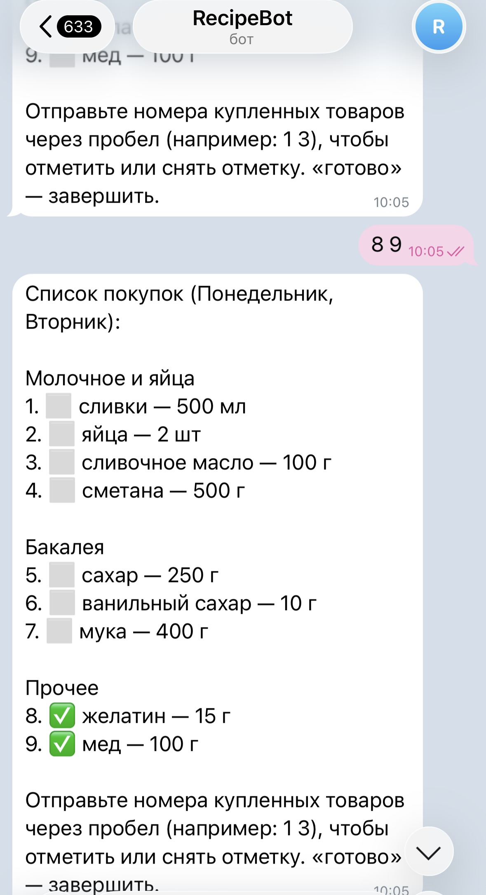
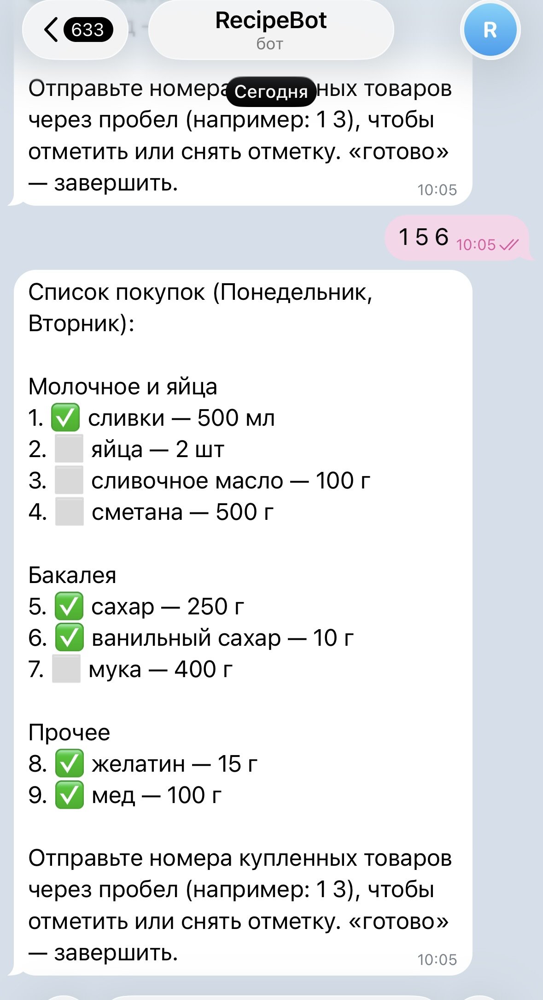

"RecipeBot"
Telegram-бот для планирования рецептов и списков покупок.
Лабораторная работа №3, вариант 10.

Возможности
- /recipes — список рецептов, просмотр рецепта целиком и добавление своего
  (название, ингредиенты, шаги).
- /plan — план блюд на неделю: можно назначить рецепт на любой день.
- /shopping_list — список покупок из блюд на выбранные дни. Одинаковые
  ингредиенты суммируются, продукты группируются по категориям
  (овощи и фрукты, молочное и яйца, мясо и рыба, бакалея, прочее). Купленное можно отмечать.

У каждого пользователя свои рецепты, план и списки: данные разных пользователей не пересекаются.

Команды
| `/start` - приветствие и список команд |
| `/help` - список команд |
| `/recipes` - список рецептов |
| `/recipes 2` - подробности рецепта №2 |
| `/recipes add` - добавить свой рецепт |
| `/plan` - показать план на неделю |
| `/plan set` - назначить рецепт на день |
| `/plan clear` - очистить план |
| `/shopping_list` - составить список покупок |
| `/cancel` - отменить текущее действие |

Любая команда прерывает текущее многошаговое действие.

Примеры работы
1) Приветствие


2) Список рецептов


3) Добавление рецепта
Ингредиенты вводятся по одному на строку в формате `название - количество единица`,
например `молоко - 200 мл`.



План на неделю




Список покупок по категориям



6) Отметка купленного
Отправьте номера купленных товаров (например `1 3`), повторная отправка снимает отметку.


Установка и запуск
Требуется Node.js 18 или новее.

1. Установите зависимости:
   ```bash
   npm install
   ```
2. Получите токен бота: в Telegram откройте [@BotFather](https://t.me/BotFather),
   отправьте `/newbot`, задайте имя и username бота (username должен заканчиваться на `bot`)
   и скопируйте выданный токен.
3. Создайте в корне проекта файл `.env` по образцу `.env.example` и вставьте токен:
   ```
   TELEGRAM_BOT_TOKEN = 'ваш_токен'
   ```
4. Запустите бота:
   ```bash
   npm start
   ```

Файл `.env` добавлен в `.gitignore` и не попадает в репозиторий.

Проверка качества

```bash
npm run lint           # проверка кода ESLint
npm run lint:fix       # автоисправление замечаний
npm test               # тесты
npm run test:coverage  # тесты с отчётом о покрытии (порог 70%)
```

Структура проекта
```
src/
├── bots/telegramBot.js          # подключение к Telegram, передача сообщений обработчику
├── handlers/
│   ├── messageHandler.js        # маршрутизация команд и шагов сценариев
│   ├── recipesHandler.js        # команда /recipes
│   ├── planHandler.js           # команда /plan
│   └── shoppingHandler.js       # команда /shopping_list
├── utils/
│   ├── categories.js            # категории продуктов
│   ├── days.js                  # дни недели
│   ├── shopping.js              # сборка списка покупок
│   ├── validators.js            # проверка пользовательского ввода
│   └── index.js
├── fsm.js                       # конечный автомат: состояния и переходы
├── store.js                     # данные пользователей (отдельно для каждого userId)
└── index.js                     # точка входа
tests/                           # тесты Jest
```


Конечный автомат.
Многошаговые команды реализованы через конечный автомат (`src/fsm.js`).
У каждого пользователя в каждый момент одно состояние, допустимые переходы заданы таблицей:

- добавление рецепта: `IDLE → RECIPE_NAME → RECIPE_INGREDIENTS → RECIPE_STEPS → IDLE`
- назначение блюда: `IDLE → PLAN_DAY → PLAN_RECIPE → IDLE`
- список покупок: `IDLE → SHOP_DAYS → SHOP_LIST → IDLE`

Независимость пользователей.
Состояние и данные хранятся в `Map` по идентификатору
пользователя (`src/store.js`), поэтому команды разных пользователей выполняются независимо.

Валидация.
Весь ввод проверяется (`src/utils/validators.js`): длина сообщений и названий,
формат ингредиентов, количество, номера дней и рецептов. При ошибке бот объясняет, что исправить,
и остаётся на том же шаге. Необработанные ошибки перехватываются, бот не падает.

sХранение данных.
Данные хранятся в памяти, при перезапуске бота состояние сбрасывается.