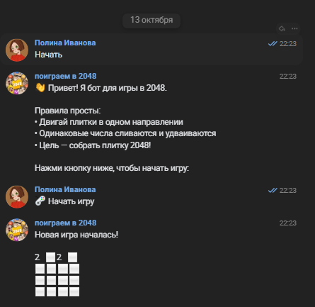
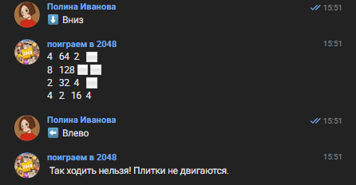
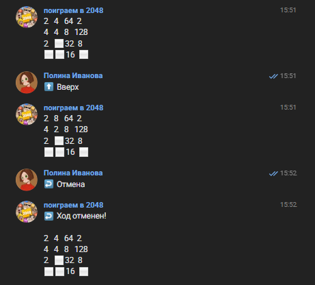

# 2048 Bot для ВКонтакте

Бот для игры в 2048 в сообщениях сообщества ВКонтакте. Реализует классическую механику игры с возможностью отмены ходов, отслеживанием состояния игры и независимыми сессиями для разных пользователей.

## ✨ Функциональность

- 🎮 Игра в 2048 через удобные кнопки или текстовые команды.
- ↩️ Отмена последнего хода (`/undo`).
- 🏆 Автоматическая проверка победы (сбор плитки 2048).
- 💀 Проверка окончания игры (отсутствие доступных ходов).
- 👥 Независимые игровые сессии для каждого пользователя.
- 🔄 Конечный автомат состояний (Idle, Playing, Game Over).

## 🚀 Установка и запуск

1. **Установите зависимости:**

   ```bash
   npm install
   ```

2. **Настройте переменные окружения:**

   Создайте в корне проекта файл `.env` и добавьте в него токен вашей группы ВКонтакте:

   ```env
   VK_TOKEN=ваш_токен_группы_здесь
   ```

   *(Важно: файл `.env` добавлен в `.gitignore` и не должен попадать в репозиторий!)*

3. **Запустите бота:**

   ```bash
   npm run start
   ```

## 🎮 Использование

### Кнопки

При первом взаимодействии бот предложит кнопку **"🎮 Начать игру"**. В процессе игры под сообщениями будет появляться панель с кнопками направлений, отмены хода и перезапуска.

### Текстовые команды

- `/new_game` — начать новую игру.
- `/move <направление>` — сделать ход. Доступные направления: `вверх`, `вниз`, `влево`, `вправо` (или `up`, `down`, `left`, `right`).
- `/undo` — отменить последний ход.
- `/help` — показать справку по командам.

## 📸 Примеры работы

### Приветствие и начало игры



### Игровой процесс





## 🧪 Тестирование

Проект покрыт тестами с использованием фреймворка **Jest**.

- **Запуск тестов:**

  ```bash
  npm run test
  ```

- **Запуск тестов с отчётом о покрытии:**

  ```bash
  npm run test:coverage
  ```

  📊 **Текущее покрытие кода: 96.96%** (требование методички: ≥ 80%).

## 🔍 Проверка кода (Linting)

Для проверки стиля кода используется **ESLint**.

- **Запуск проверки:**

  ```bash
  npm run lint
  ```

- **Автоматическое исправление ошибок стиля:**

  ```bash
  npm run lint:fix
  ```

## 📁 Структура проекта

```text
lab3-node/solutions/student-11/
├── src/
│   ├── index.js            # Точка входа, обработка событий VK API
│   ├── game.js             # Ядро игры 2048 (логика поля, ходы, слияния)
│   └── gameManager.js      # Менеджер игр (конечный автомат, хранение сессий)
├── tests/
│   ├── game.test.js        # Модульные тесты для game.js
│   └── gameManager.test.js # Модульные тесты для gameManager.js
├── .env                    # Секретный токен (не коммитить!)
├── .gitignore              # Правила игнорирования для Git
├── eslint.config.js        # Конфигурация ESLint (flat config)
├── package.json            # Зависимости и npm-скрипты
└── README.md               # Документация проекта
```

## 🛠 Технологический стек

- **Node.js** — среда выполнения.
- **vk-io** — библиотека для работы с Long Poll API ВКонтакте.
- **Jest** — фреймворк для модульного тестирования.
- **ESLint** — статический анализатор кода.
- **ES Modules** — использование современного синтаксиса `import`/`export`.
```