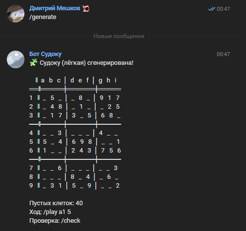
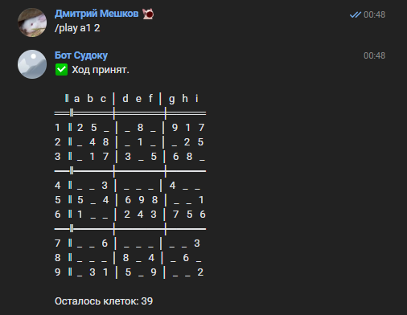
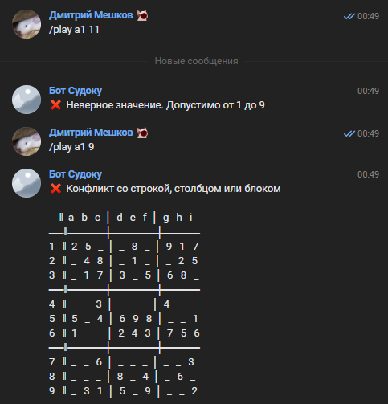

# SudokuGenBot — бот «Судоку» для ВКонтакте

Бот для игры в судоку в сообщениях сообщества ВКонтакте. Генерирует головоломки
трёх уровней сложности, проверяет ходы по строке / столбцу / блоку 3×3,
определяет победу и фиксирует время прохождения партии.

Реализован на **Node.js** с использованием **vk-io**, конечного автомата состояний
и независимых игровых сессий для каждого пользователя.

---

## ✨ Возможности

- 🧩 Генерация судоку трёх уровней сложности:
  - **лёгкая** (`easy`) — 40 пустых клеток,
  - **средняя** (`medium`) — 32 пустые клетки,
  - **сложная** (`hard`) — 26 пустых клеток.
- 🎯 Проверка корректности каждого хода: по строке, столбцу, блоку 3×3,
  а также запрет на изменение изначально заданных клеток.
- ✅ Полная проверка решения командой `/check` с указанием ошибочных клеток.
- ⏱️ Замер времени прохождения партии и сохранение статистики.
- 👥 Независимые сессии для каждого пользователя (`Map<userId, session>`).
- 🔄 Конечный автомат состояний: `IDLE`, `PLAYING`, `SOLVED`.
- 🛡️ Валидация входящих команд — бот не падает при некорректных запросах.

---

## 🚀 Установка и запуск

### 1. Установите зависимости

```bash
npm install
```

### 2. Настройте переменные окружения

Создайте в корне проекта файл `.env` на основе `.env.example`:

```env
VK_GROUP_TOKEN=ваш_токен_группы_вконтакте
```

> ⚠️ Файл `.env` добавлен в `.gitignore` и **не должен** попадать в репозиторий.

**Как получить `VK_GROUP_TOKEN`:**

1. Создайте сообщество ВКонтакте.
2. В сообществе откройте **«Управление» → «Настройки» → «Работа с API»**.
3. Нажмите **«Создать ключ»** и выдайте право `messages`.
4. Скопируйте полученный токен в `.env`.
5. В разделе **«Сообщения»** включите «Сообщения сообщества» и «Возможности ботов».
6. В разделе **«Long Poll API»** включите Long Poll.

### 3. Запустите бота

```bash
npm start
```

В консоли появится сообщение:

```
VK-бот запущен...
```

---

## 🎮 Команды

| Команда | Описание |
|---|---|
| `/generate <easy\|medium\|hard>` | Сгенерировать новую партию заданной сложности |
| `/play <клетка> <цифра>` | Сделать ход, например `/play a1 5` |
| `/check` | Проверить текущее решение |
| `/reset` | Сбросить текущую партию |
| `/help` | Справка по командам |

### Формат координат

- **Столбцы** обозначаются латинскими буквами `a`–`i`.
- **Строки** — числами `1`–`9`.
- Пример: `a1` — левая верхняя клетка, `i9` — правая нижняя.

## 📸 Скриншоты

[](screenshots/generate.png)
---

[](screenshots/play.png)
---

[](screenshots/play1.png)
## 📁 Структура проекта

```
.
├── src/
│   ├── bots/
│   │   └── vkBot.js              # Инициализация VK-бота, обработка событий
│   ├── game/
│   │   ├── Sudoku.js             # Ядро игры: генерация, ходы, проверка, рендер
│   │   ├── SudokuManager.js      # Конечный автомат + независимые сессии
│   │   └── GameState.js          # Константы состояний
│   ├── handlers/
│   │   └── messageHandler.js     # Роутер текстовых команд
│   ├── utils/
│   │   ├── index.js
│   │   ├── math.js
│   │   └── sudokuHelpers.js      # Парсинг координат, проверки
│   └── index.js                  # Точка входа (dotenv + запуск VK-бота)
├── tests/
│   ├── math.test.js
│   ├── sudoku.test.js
│   ├── sudokuManager.test.js
│   ├── messageHandler.test.js
│   └── vkBot.test.js
├── .env.example                  # Шаблон переменных окружения
├── .gitignore
├── eslint.config.js              # ESLint flat config
├── jest.config.json              # Конфигурация Jest и coverage
├── package.json
└── README.md
```

---

## 🛠 Технологический стек

- **Node.js** — среда выполнения.
- **vk-io** — библиотека для работы с Long Poll API ВКонтакте.
- **Jest** — модульное тестирование.
- **ESLint** — статический анализатор кода.
- **ES Modules** — синтаксис `import` / `export`.
- **dotenv** — загрузка переменных окружения из `.env`.

---