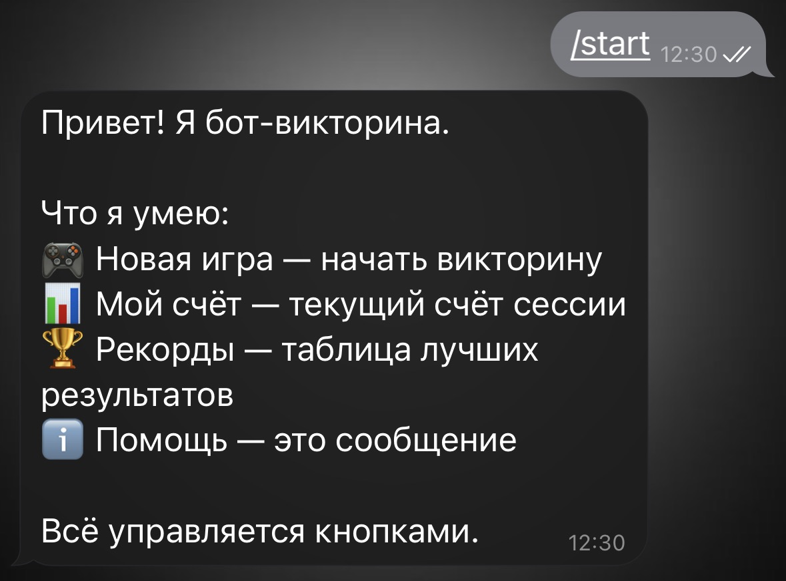
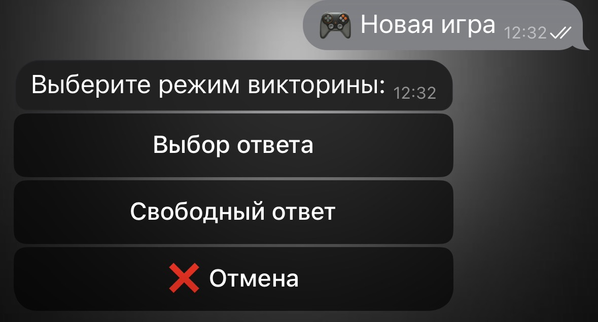
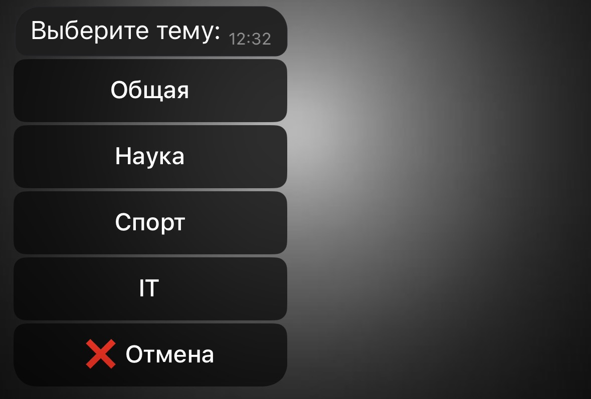
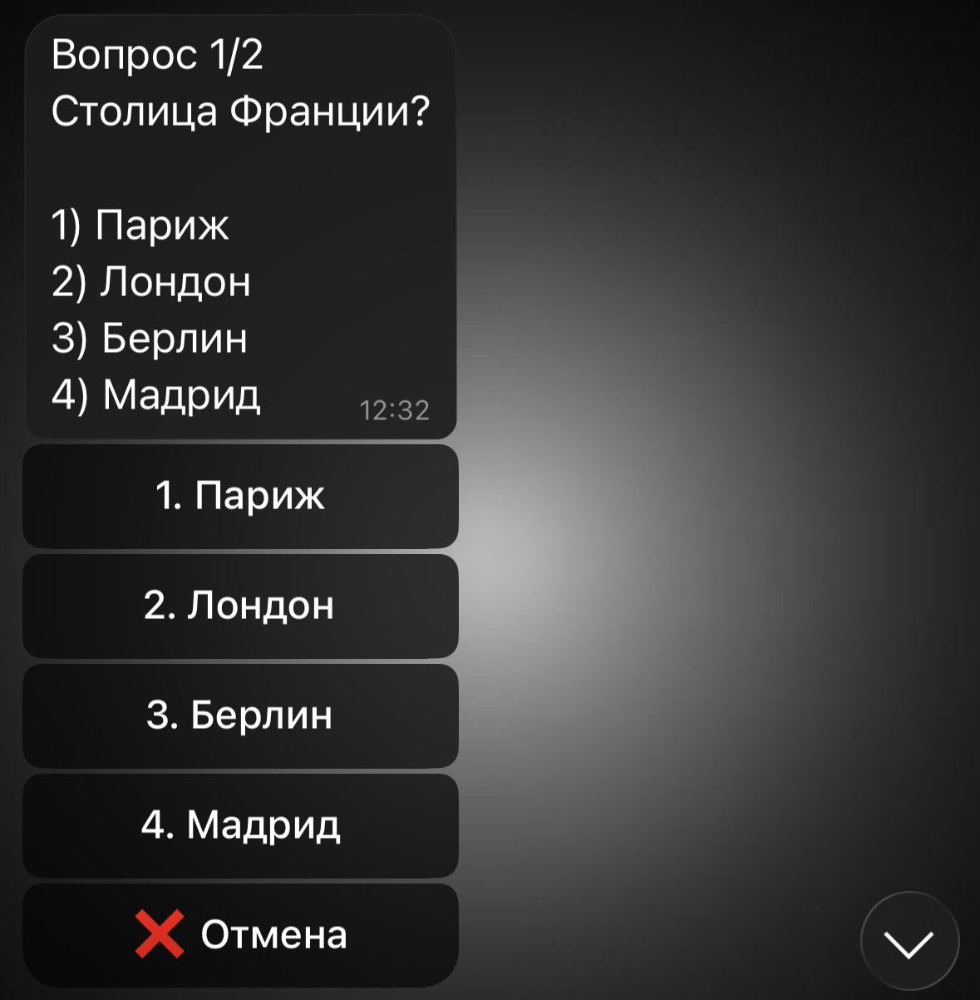
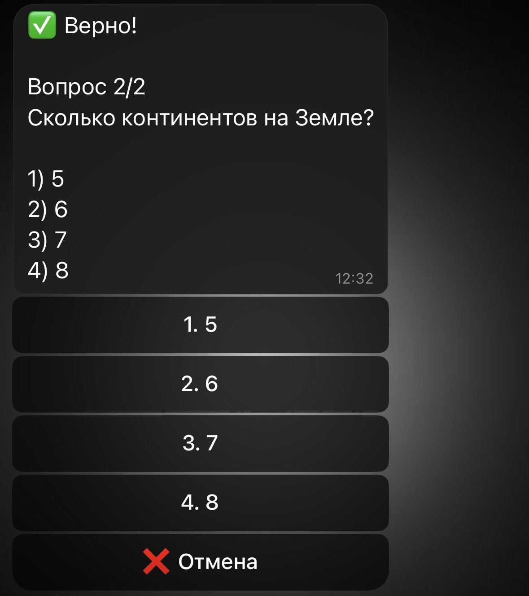
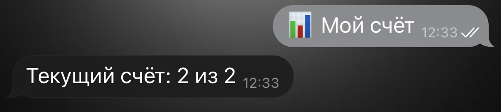
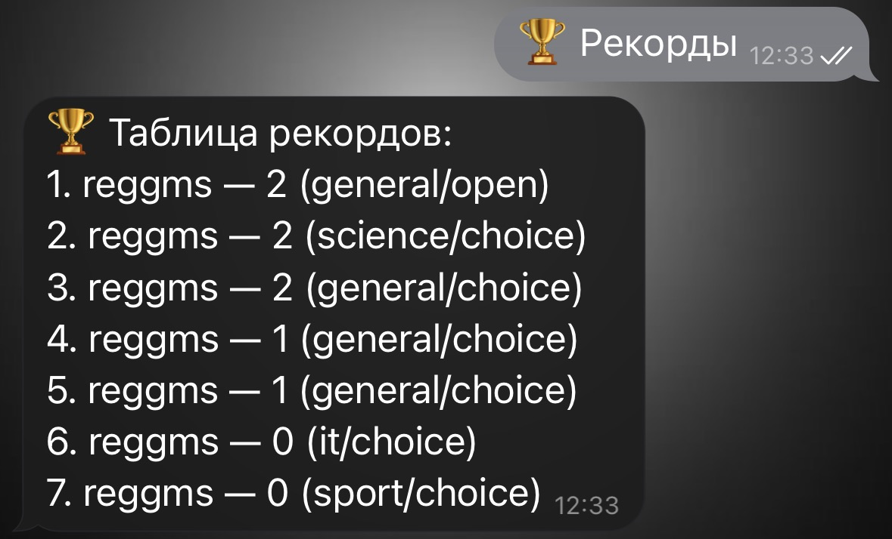
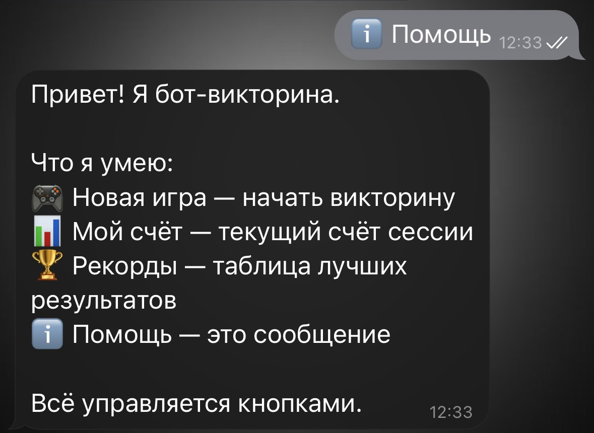

# QuizBot

Телеграм-бот для игры в викторину с двумя режимами (выбор ответа и свободный ответ),
четырьмя темами (общая, наука, спорт, IT) и таблицей рекордов.

# Функционал

- `/start` — вывод приветствия с инструкцией использования меню.
- `/new_quiz` — начать игру: выбор режима и темы, последовательные вопросы.
- `/score` — текущий счёт сессии.
- `/records` — таблица лучших результатов.
- Результат сохраняется автоматически после завершения игры.
- Каждый пользователь имеет независимое состояние (конечный автомат).
- Перезапуск бота сбрасывает активные сессии, но не рекорды.

# Пример работы

# Команда /start

# Новая игра

# Выбор темы

# Первый вопрос

# Второй вопрос

# Конец игры

# Просмотр текущего счета
# (можно использовать команду /score)

# Просмотр таблицы рекордов
# (можно использовать команду /records)

# Помощь
# (можно использовать команду /help)
