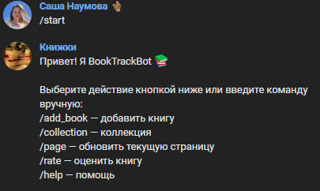
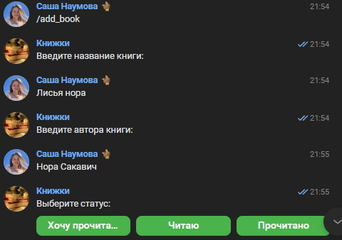
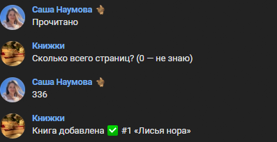
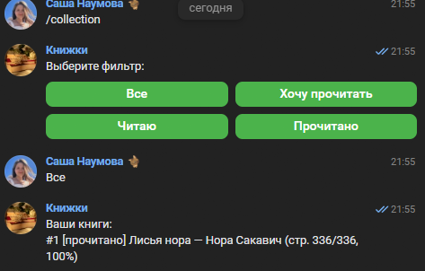
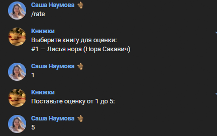
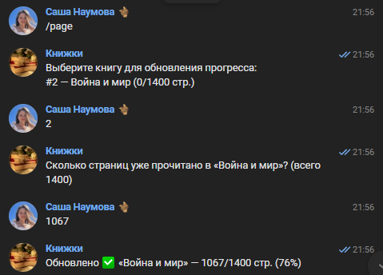

# BookTrackBot

VK-бот для отслеживания коллекции книг, статусов чтения и рейтингов.
Node.js + ESM + FSM + vk-io.

## Команды

- `/add_book` — название → автор → статус → страницы.
- `/collection` — фильтр по статусу и прогресс чтения.
- `/rate` — оценка 1–5 + средний рейтинг + рекомендации.
- `/page` — указать, сколько страниц уже прочитано (для книг со статусом «читаю»).
- `/help`, `/start`.

## Запуск

```bash
npm install
cp .env.example .env
# вписать VK_GROUP_TOKEN
npm start
```

## Скрипты

| Команда | Назначение |
| `npm start` | запуск бота |
| `npm run lint` | ESLint |
| `npm test` | Jest |
| `npm run test:coverage` | Jest + coverage |

## Скриншоты

### /start


### /add_book



### /collection


### /rate


### /page


## Архитектура

- `src/index.js` — точка входа.
- `src/bots/vkBot.js` — транспорт VK + Storage.
- `src/handlers/messageHandler.js` — FSM + логика команд.
- `src/utils/parseInput.js` — валидация.
- `src/utils/format.js` — форматирование и рекомендации.