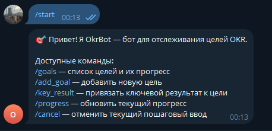
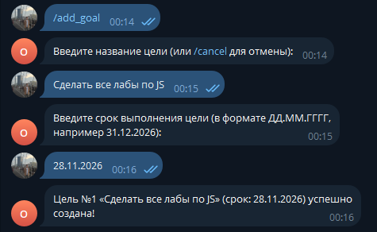
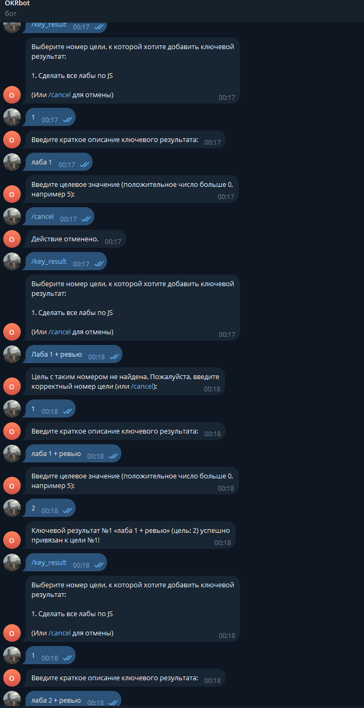
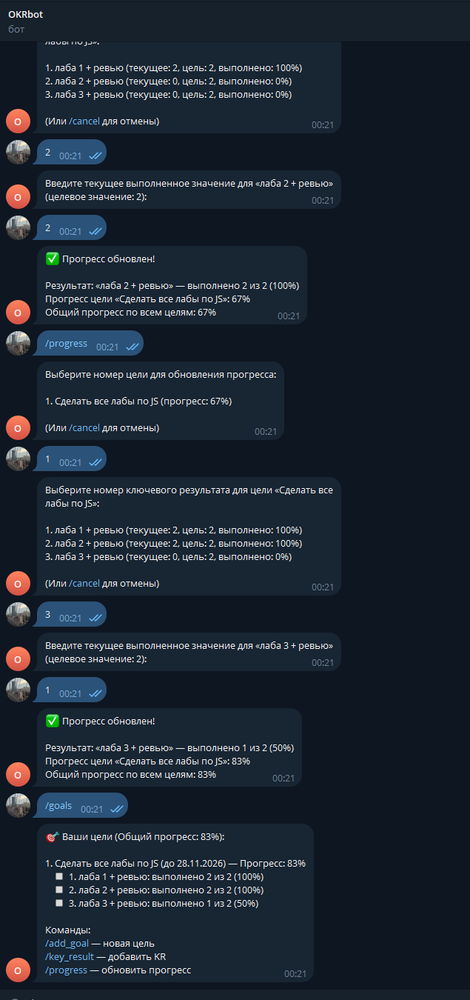

# OkrBot — Бот-трекер целей OKR

Telegram-бот для отслеживания личных целей в стиле OKR (*Objectives and Key Results*) с ключевыми результатами.

## Описание проекта

Бот позволяет ставить цели (**Objectives**), привязывать к ним измеримые ключевые результаты (**Key Results**) и отслеживать динамику их достижения с автоматическим пересчетом прогресса.

## Функциональные возможности

- `/goals` — просмотр списка целей с прогрессом выполнения и привязанными ключевыми результатами
- `/add_goal` — пошаговое добавление новой цели (название и срок выполнения)
- `/key_result` — привязка ключевого результата к выбранной цели (краткое описание и целевое значение)
- `/progress` — отметка текущего значения ключевого результата с автоматическим расчетом:
  - процента выполнения ключевого результата: $\min(100, \frac{\text{текущее}}{\text{цель}} \times 100\%)$
  - процента выполнения цели (средняя доля выполненных ключевых результатов)
  - общего прогресса по всем целям пользователя
- `/cancel` — отмена текущего пошагового ввода и возврат в состояние ожидания
- Пошаговые сценарии реализованы на базе конечного автомата (FSM)
- Полная изоляция данных и состояний между пользователями по `userId`
- Валидация входящих данных (запрет слэшей в названиях, проверка будущих календарных дат, положительных чисел)

## Структура проекта

```
solutions/student-18/
├── .env.example              # образец переменных окружения
├── .gitignore                # исключение node_modules, .env, coverage
├── eslint.config.js          # конфигурация ESLint (2 пробела)
├── jest.config.json          # конфигурация тестов и пороги покрытия (>= 70%)
├── package.json              # манифест проекта и скрипты
├── README.md                 # документация
├── images/                   # скриншоты работы бота
│   ├── start.png
│   ├── add_goal.png
│   ├── key_result.png
│   └── progress.png
├── src/
│   ├── index.js              # точка входа
│   ├── bots/
│   │   └── telegramBot.js    # транспортный уровень Telegram Bot API
│   ├── fsm/
│   │   └── stateManager.js   # конечный автомат (FSM)
│   ├── handlers/
│   │   └── messageHandler.js # маршрутизация команд и шагов
│   ├── services/
│   │   └── okrService.js     # логика OKR и расчет процентов
│   └── utils/
│       ├── index.js          # реэкспорт утилит
│       └── validator.js      # валидация ввода
└── tests/
    ├── messageHandler.test.js
    ├── okrService.test.js
    ├── stateManager.test.js
    ├── telegramBot.test.js
    └── validator.test.js
```

## Инструкция по запуску

1. Установите зависимости:
   ```sh
   npm install
   ```
2. Создайте файл `.env` на основе `.env.example`:
   ```sh
   cp .env.example .env
   ```
   и укажите токен вашего бота от [@BotFather](https://t.me/BotFather):
   ```env
   TELEGRAM_BOT_TOKEN="ваш_токен"
   ```
3. Запустите бота:
   ```sh
   npm start
   ```
   *(для разработки с автоперезапуском: `npm run dev`)*
4. Запуск тестов и линтера:
   ```sh
   npm test               # запуск 42 тестов
   npm run test:coverage  # сбор покрытия (coverage >= 70%)
   npm run lint           # проверка стиля кода через ESLint
   ```

## Примеры работы

### 1. Приветствие и справка (`/start`)



### 2. Добавление цели (`/add_goal`)



### 3. Добавление ключевого результата (`/key_result`)



### 4. Обновление прогресса и просмотр целей (`/progress`, `/goals`)



## Технические детали

- Проект настроен как ES-модуль (`"type": "module"`)
- Отсутствуют `var`, `require`, `module.exports`
- Используется библиотека `node-telegram-bot-api`
- Секретный токен хранится в `.env`, папки `node_modules` и `coverage` добавлены в `.gitignore`
- ESLint: отступы ровно в 2 пробела, 0 ошибок и 0 предупреждений
- Тесты: 42 модульных теста, покрытие тестами > 70%
