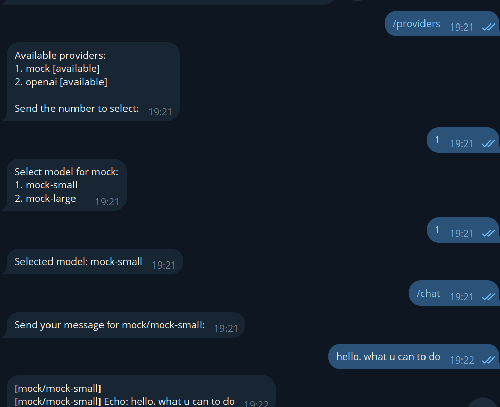
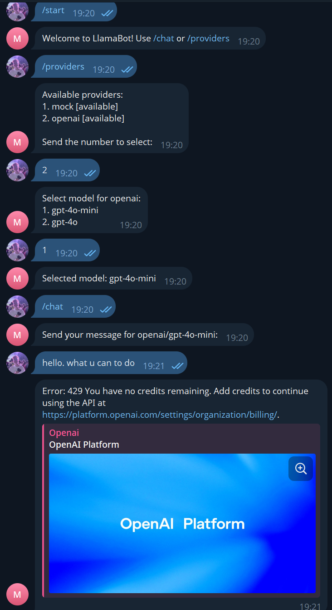

# LlamaBot

Многофункциональный LLM-хаб: Telegram-бот и REST API с единым интерфейсом к нескольким LLM-провайдерам.

## Возможности

- Единый интерфейс к нескольким LLM-провайдерам (OpenAI, mock-провайдер для демонстрации)
- Telegram-бот с командами `/chat` и `/providers`
- REST API: `POST /api/chat`, `GET /api/providers`
- Конечный автомат для пошагового выбора провайдера и модели
- Изолированные состояния пользователей
- Персистентность состояний в JSON (бонус)
- Валидация входящих запросов

## Структура

```
src/
├── index.js           # точка входа
├── api/index.js       # Express API
├── bot/               # Telegram-бот (Telegraf)
│   ├── handlers.js    # обработчики команд и FSM
│   └── index.js
├── providers/         # провайдеры LLM
│   ├── index.js       # реестр
│   ├── mock.js        # мок-провайдер
│   └── openai.js      # OpenAI
└── state/index.js     # FSM + персистентность
```

## Установка

```bash
npm install
```

## Конфигурация

Создайте файл `.env` на основе `.env.example`:

```
TELEGRAM_BOT_TOKEN=...
OPENAI_API_KEY=...
PORT=3000
```

> Если `TELEGRAM_BOT_TOKEN` не задан — приложение запустится в режиме «только API».
> Если `OPENAI_API_KEY` не задан — будет доступен только `mock`-провайдер.

## Запуск

```bash
npm start
```

## Скрипты

| Команда | Описание |
|---|---|
| `npm start` | Запуск приложения |
| `npm run lint` | Проверка кода |
| `npm run lint:fix` | Авто-исправление |
| `npm test` | Запуск тестов |
| `npm run test:coverage` | Тесты с отчётом покрытия |

## Использование

### Telegram-бот

1. `/start` — приветствие
2. `/providers` — список провайдеров, выбор активного (пошагово: провайдер → модель)
3. `/chat` — отправка сообщения в выбранную модель, возврат ответа с указанием провайдера и модели

### REST API

```bash
# Список провайдеров
curl http://localhost:3000/api/providers

# Чат
curl -X POST http://localhost:3000/api/chat \
  -H "Content-Type: application/json" \
  -d '{"provider":"mock","model":"mock-small","message":"Hello!"}'
```

Ответ:

```json
{
  "reply": "[mock/mock-small] Echo: Hello!",
  "provider": "mock",
  "model": "mock-small"
}
```

## Примеры работы

### Пример 1: На основе мок данных



### Пример 2: На основе OpenAI



> Скриншоты делаются после запуска приложения и помещаются в `docs/screenshots/`.

## Требования

- Node.js ≥ 18
- npm ≥ 9