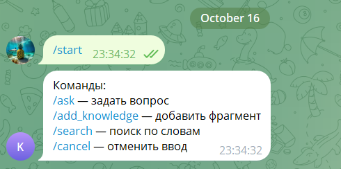
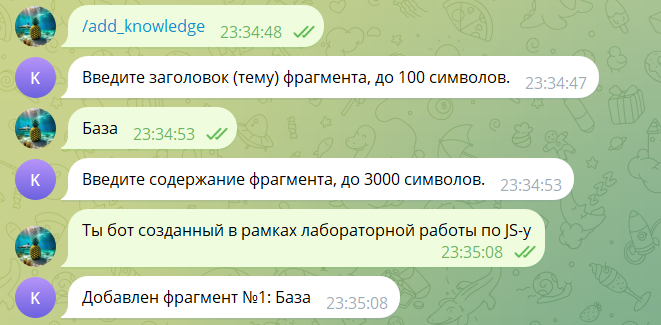
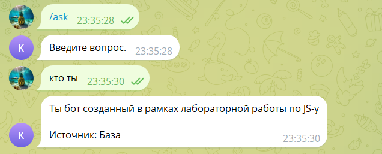
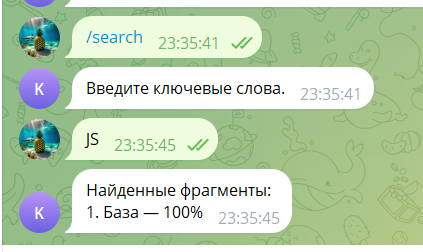
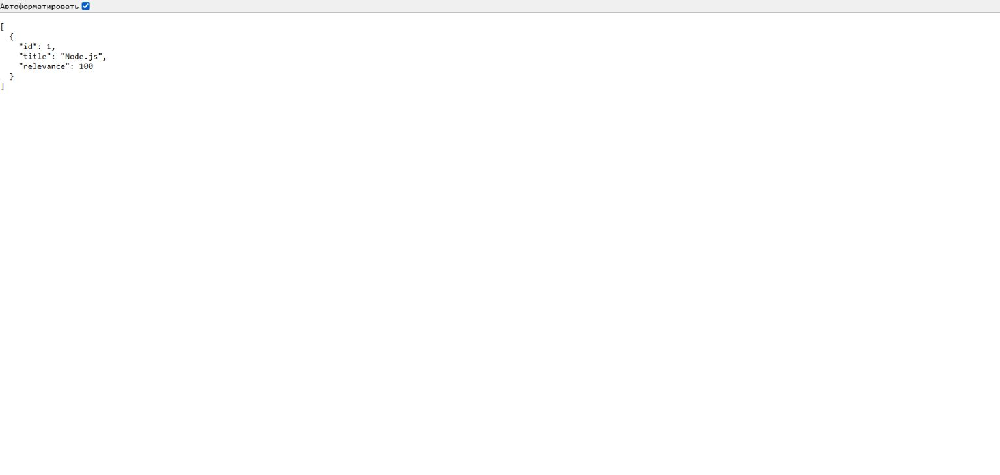
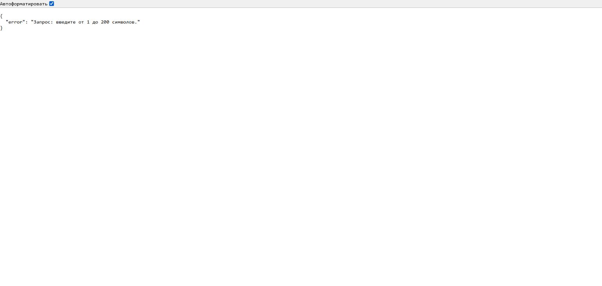

# KnowledgeBaseBot

Лабораторная работа №3, вариант 20. Telegram-бот хранит фрагменты базы знаний, ищет их по словам и отвечает с указанием источника. Те же данные доступны через HTTP API.

## Запуск

Нужен Node.js 20.19 или новее. Команды выполняются из этой папки:

```powershell
npm ci
if (-not (Test-Path .env)) { Copy-Item .env.example .env }
npm start
```

Не перезаписывайте `.env`, если уже заполнили его. В нём две настройки:

```dotenv
TELEGRAM_BOT_TOKEN=
PORT=3000
```

API запускается на `http://127.0.0.1:3000`. Если токен пустой, доступен только API. Для подключения Telegram укажите токен своего бота в `.env` и перезапустите приложение. Токен можно получить через BotFather. Настоящий токен нельзя добавлять в Git или скриншоты.

Остановка: Ctrl+C. Если порт занят, измените `PORT`. API слушает только локальный адрес компьютера.

## Команды бота

- `/start`, `/help` — справка.
- `/add_knowledge` — последовательно ввести заголовок и содержание фрагмента.
- `/ask вопрос` — получить лучший найденный фрагмент с источником.
- `/search слова` — показать до пяти результатов с релевантностью.
- `/cancel` — отменить текущий ввод.

Для `/ask` и `/search` можно отправить команду отдельно, затем следующим сообщением ввести запрос. Любая новая команда прерывает предыдущий сценарий.

Пример диалога:

```text
Пользователь: /add_knowledge
Бот: Введите заголовок (тему) фрагмента, до 100 символов.
Пользователь: Node.js
Бот: Введите содержание фрагмента, до 3000 символов.
Пользователь: Среда выполнения JavaScript вне браузера.
Бот: Добавлен фрагмент №1: Node.js

Пользователь: /ask javascript
Бот: Среда выполнения JavaScript вне браузера.

Источник: Node.js

Пользователь: /search javascript
Бот: Найденные фрагменты:
1. Node.js — 100%
```

Заголовок является темой фрагмента. Для добавления используется конечный автомат:

```text
нет диалога → /add_knowledge → ввод заголовка → ввод содержания → сохранение
нет диалога → /ask           → ввод вопроса   → ответ
нет диалога → /search        → ввод запроса   → результаты
любой шаг  → /cancel        → нет диалога
```

Ошибочный ввод оставляет пользователя на текущем шаге. Состояние хранится по паре «чат + пользователь»: участники группы и разные чаты одного пользователя не мешают друг другу. Сама база знаний общая для бота и API.

В группе бот должен получать текстовые сообщения для пошагового ввода. Если Telegram скрывает их в режиме приватности, проверяйте бот в личном чате либо настройте режим получения сообщений своего бота через BotFather. Команды, адресованные другому боту, игнорируются.

## HTTP API

### Добавить фрагмент

```http
POST /api/knowledge
Content-Type: application/json

{"title":"Node.js","content":"Среда выполнения JavaScript вне браузера."}
```

Успех: HTTP 201.

```json
{
  "id": 1,
  "title": "Node.js",
  "content": "Среда выполнения JavaScript вне браузера."
}
```

Пример для PowerShell:

```powershell
$body = @{
  title = 'Node.js'
  content = 'Среда выполнения JavaScript вне браузера.'
} | ConvertTo-Json

Invoke-RestMethod -Method Post -Uri 'http://127.0.0.1:3000/api/knowledge' `
  -ContentType 'application/json; charset=utf-8' `
  -Body ([System.Text.Encoding]::UTF8.GetBytes($body))
```

### Найти фрагменты

```http
GET /api/search?query=javascript
```

Успех: HTTP 200. API возвращает все совпадения без текста фрагментов:

```json
[{"id":1,"title":"Node.js","relevance":100}]
```

```powershell
Invoke-RestMethod 'http://127.0.0.1:3000/api/search?query=javascript'
```

Для русских слов используйте URL-кодирование, например `[uri]::EscapeDataString('база знаний')`.

Если совпадений нет, возвращается `[]`. Некорректные поля и запросы дают HTTP 400 с объектом `{"error":"описание"}`; тело более 32 КБ — HTTP 413; неизвестный маршрут — HTTP 404.

## Поиск и ограничения

Текст разбивается на слова и числа. Регистр не учитывается, `ё` заменяется на `е`. Повторения слов запроса удаляются. Слова ищутся и в заголовке, и в содержании.

Релевантность — процент уникальных слов запроса, найденных во фрагменте. Если из двух слов найдено одно, результат — 50%. Сортировка: сначала большая релевантность, при равенстве — меньший id. `/ask` возвращает содержание первого результата и название источника.

Это поиск по точным словам без синонимов и склонений: «книга» и «книги» считаются разными словами. Внешняя языковая модель не используется.

Ограничения после удаления крайних пробелов: заголовок 1–100 символов, содержание 1–3000, запрос 1–200. Запрос должен содержать хотя бы одно слово или число. Данные и незаконченные диалоги хранятся в памяти и теряются после перезапуска. Сохранение между запусками — необязательный бонус задания, здесь оно не реализовано.

## Структура

```text
src/knowledge.js — хранение, валидация и поиск
src/api.js       — маршруты Express и обработка ошибок
src/messages.js  — команды и состояния диалогов
src/telegram.js  — подключение обработчика к Telegraf
src/index.js     — настройки и запуск
tests/           — HTTP, команды, Telegram-адаптер
docs/            — скриншоты и результаты проверок
```

## Проверки

```powershell
npm run lint
npm run lint:fix
npm test
npm run test:coverage
```

ESLint использует правила примера, включая отступы 2 пробела, и запрещает предупреждения. Jest проверяет API, поиск, валидацию, состояния диалогов, независимость пользователей и Telegram-адаптер. Подменяется только внешний Telegram API; настоящий токен для тестов не нужен. Минимум покрытия branches/functions/lines — 70%. Из покрытия исключена только точка входа `src/index.js`, как в примере задания.

Результаты конкретного запуска и границы проверки: [docs/checks.md](docs/checks.md).

## Скриншоты бота

Реальный диалог с `@bot_for_Knowledge_Basebot`, 16.10.2026.

`/start` — список доступных команд:



`/add_knowledge` — пошаговое добавление заголовка и содержания фрагмента:



`/ask` — ответ из базы знаний с названием источника:



`/search` — поиск по ключевым словам с релевантностью:



## Скриншоты локального API

На снимках приложение запущено с `PORT=30320`. Перед поиском фрагмент добавлен через `POST /api/knowledge`.

Поиск `GET /api/search?query=javascript`:



Запрос `GET /api/search` без обязательного параметра:



Команды `/start`, `/add_knowledge`, `/ask` и `/search` проверены в реальном Telegram-чате, результаты показаны выше. Токен хранится в `.env`, исключённом из Git.
