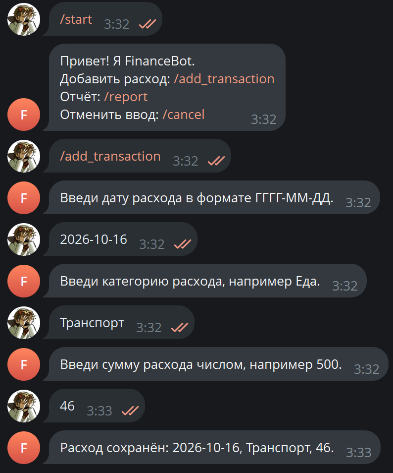
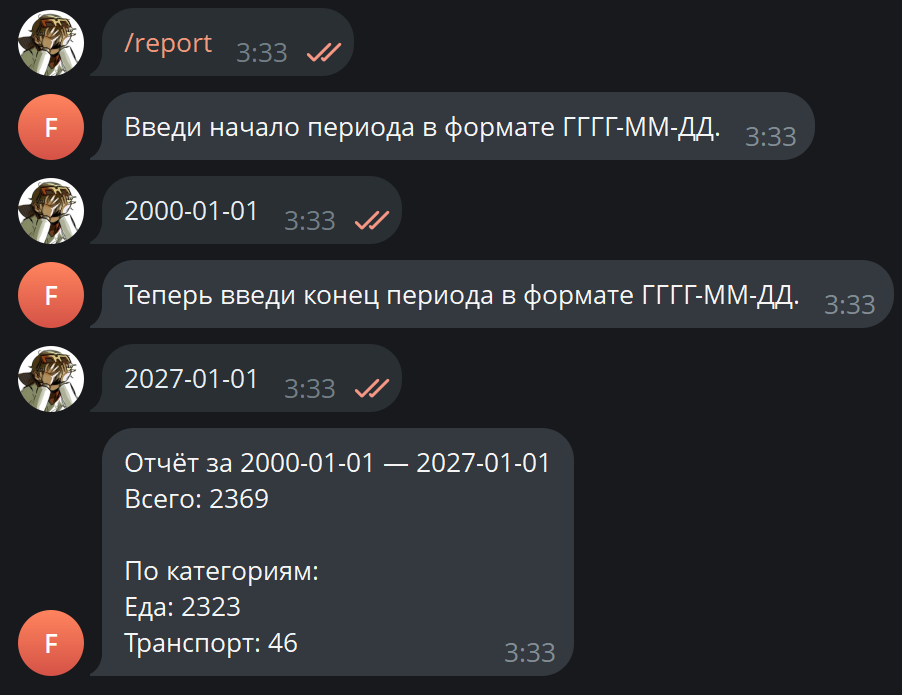

# FinanceBot

Telegram-бот и REST API для учёта расходов и формирования отчётов по категориям.

## Возможности

- Добавление расходов через пошаговый диалог в Telegram.
- Проверка даты, категории и суммы расхода.
- Отмена текущего ввода командой `/cancel`.
- Формирование отчётов за указанный период.
- Группировка расходов по категориям.
- REST API для добавления транзакций и получения отчётов.
- Сохранение транзакций в JSON-файл `data/transactions.json`.

## Требования

- Node.js
- npm
- Токен Telegram-бота, полученный через BotFather

## Установка

Клонируйте репозиторий и перейдите в папку проекта:

```bash
git clone <URL-РЕПОЗИТОРИЯ>
cd <ПАПКА-ПРОЕКТА>
npm install
```

Создайте файл `.env` в корне проекта:

```dotenv
TELEGRAM_BOT_TOKEN=ваш_токен_бота
```

Не добавляйте `.env` и реальные токены в Git.

## Запуск Telegram-бота

```bash
npm start
```

Откройте бота в Telegram и отправьте `/start`.

### Команды бота

| Команда | Описание |
|---|---|
| `/start` | Показать приветствие и доступные команды |
| `/add_transaction` | Начать добавление расхода |
| `/report` | Сформировать отчёт за период |
| `/cancel` | Отменить текущий ввод |

При добавлении расхода бот запрашивает дату в формате `ГГГГ-ММ-ДД`, категорию и сумму.

## REST API

Запустите API в отдельном терминале:

```bash
npm run start:api
```

По умолчанию сервер использует порт `3000`. При необходимости его можно изменить через переменную окружения `PORT`.

### Добавление транзакции

`POST /api/transactions`

Пример JSON-тела запроса:

```json
{
  "date": "2026-10-16",
  "category": "Еда",
  "amount": 250
}
```

Успешный ответ имеет формат:

```json
{
  "ok": true,
  "saved": {
    "date": "2026-10-16",
    "category": "Еда",
    "amount": 250
  }
}
```

### Получение отчёта

`GET /api/report?from=2026-10-01&to=2026-10-31`

Ответ содержит общую сумму расходов и суммы по категориям:

```json
{
  "total": 250,
  "byCategory": {
    "Еда": 250
  }
}
```

## Тестирование и проверка кода

Запустить тесты:

```bash
npm test
```

Проверить стиль кода:

```bash
npm run lint
```

Автоматически исправить поддерживаемые ошибки стиля:

```bash
npm run lint:fix
```

Запустить тесты с отчётом о покрытии:

```bash
npm run test:coverage
```

## Хранение данных

Транзакции сохраняются в `data/transactions.json`. Файл создаётся при первом сохранении транзакции. Не добавляйте личные данные и содержимое хранилища в репозиторий.

## Скриншоты

В папке images представлены примеры работы с основными командами бота

Пример работы /add_transaction (Добавить транзакцию)


Пример работы /report (Получить отчет за период)

