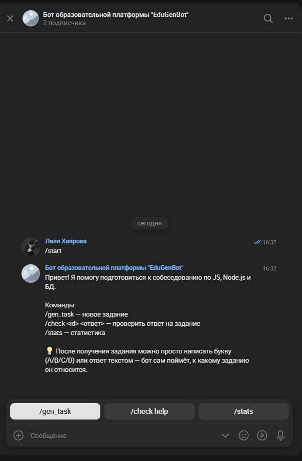
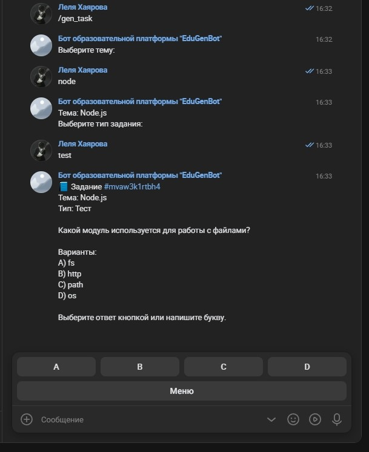
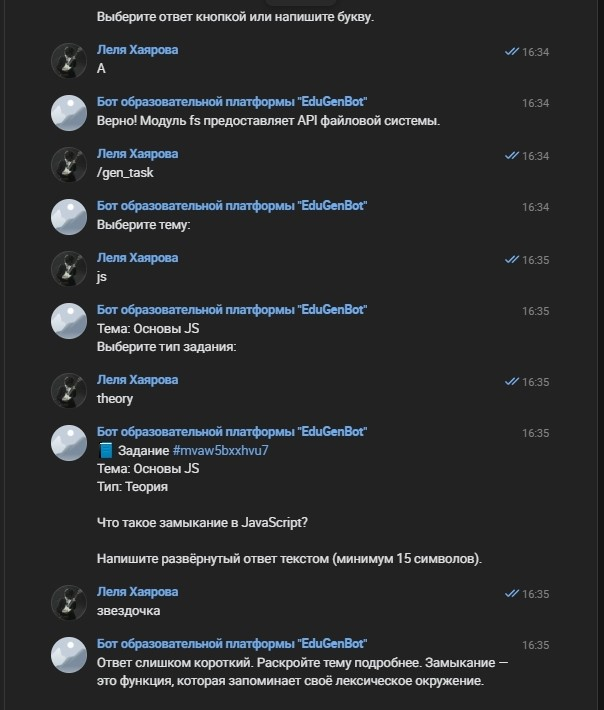
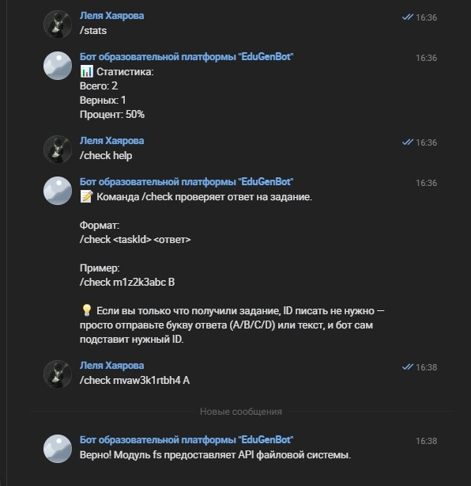
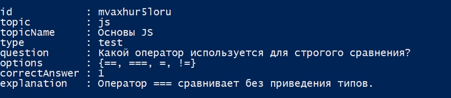

# EduGenBot

VK-бот и REST API для генерации и проверки учебных заданий по темам:
Основы JS, Node.js, Базы данных.

## Установка

```powershell
npm install
Copy-Item .env.example .env
```

В файл `.env` впишите свой `VK_TOKEN` из настроек сообщества ВКонтакте.

## Запуск

```powershell
npm run start
```

Ожидаемый вывод:

```
API слушает http://localhost:3000
VK-бот запущен
```

## Скрипты

- `npm run start` — запуск бота и API
- `npm run lint` — проверка кода
- `npm test` — тесты
- `npm run test:coverage` — тесты с покрытием

## Команды VK-бота

### /start

Приветствие и главное меню. Отправляет список команд и клавиатуру
с кнопками /gen_task, /check help, /stats.

### /gen_task

Запускает пошаговый диалог:

1. Выбор темы: js, node, db.
2. Выбор типа: theory (теория) или test (тест).
3. Бот присылает сгенерированное задание.

### /check <id> <ответ>

Проверка ответа на конкретное задание.

Пример: /check mva3oupohjrb B

Бот отвечает, верный ответ или нет, и добавляет пояснение.
Если задание только что получено, можно просто отправить букву
(A/B/C/D) или текст — бот сам определит, к какому заданию ответ.

### /stats

Показывает статистику пользователя: всего заданий, верных, процент.

## Скриншоты








## Структура

```
src/     — исходный код
tests/   — тесты
docs/    — скриншоты
```