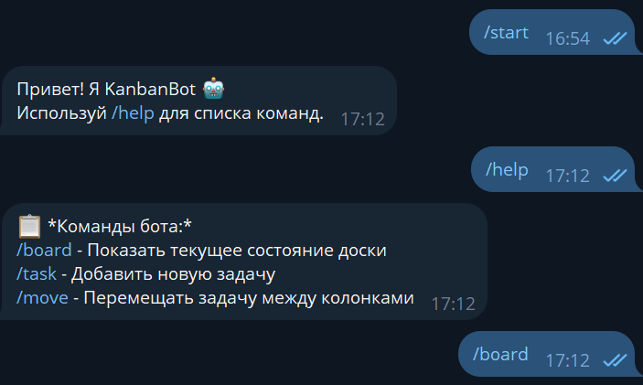
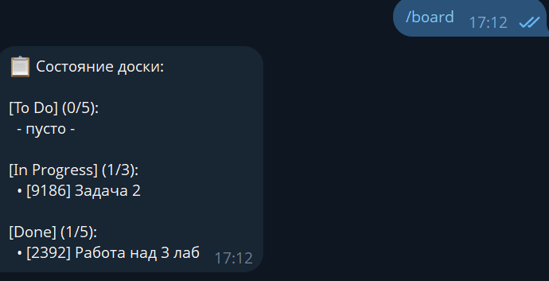
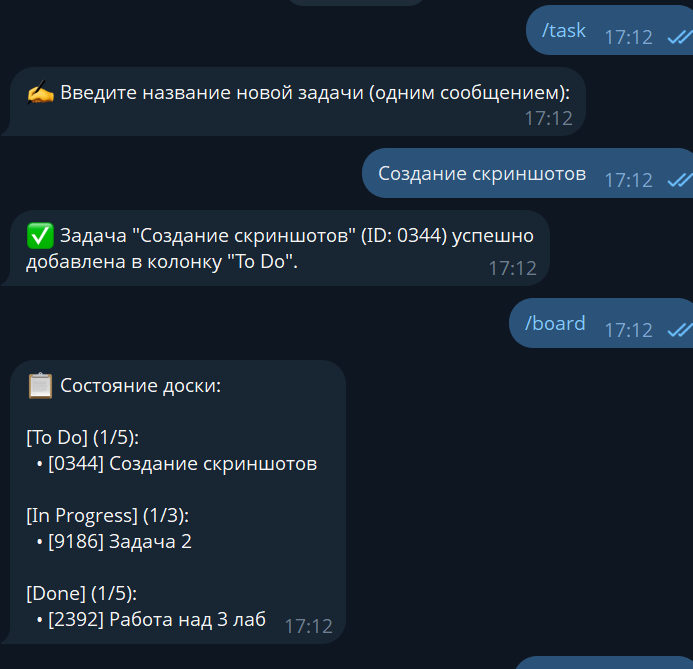
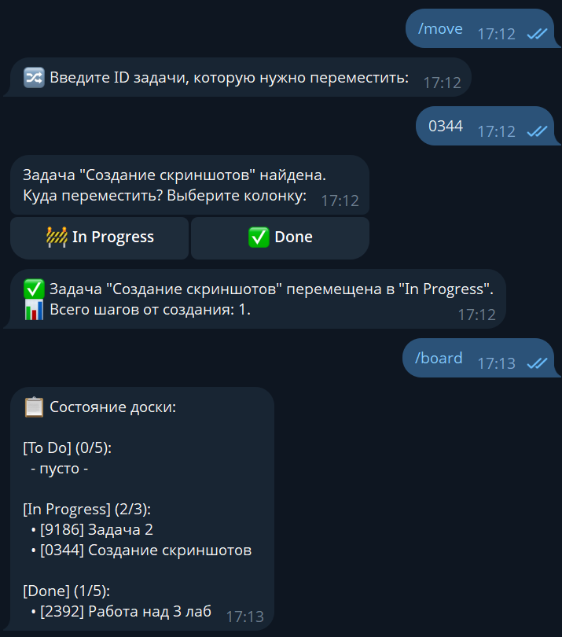

# KanbanBot — Бот-симулятор Kanban-системы

##  Описание проекта

Telegram-бот и REST API для управления задачами по методологии Kanban. Проект имитирует работу Kanban-доски с колонками **To Do**, **In Progress** и **Done**, с контролем лимитов незавершённой работы (WIP).

Проект разработан в рамках лабораторной работы по изучению принципов управления проектами, конечных автоматов (FSM) и работы с Telegram API.

## ✨ Функциональные возможности

- 📋 **Просмотр доски** — отображение текущего состояния всех колонок с лимитами WIP
- ➕ **Создание задач** — добавление новых задач в колонку "To Do"
- 🔀 **Перемещение задач** — перемещение между колонками через inline-кнопки
- ✅ **Контроль WIP-лимитов** — ограничение на количество задач в "In Progress" (максимум 3)
- 📊 **Подсчёт шагов** — отслеживание количества переходов задачи от создания до текущего статуса
- 💾 **Сохранение состояния** — данные сохраняются в JSON и переживают перезапуск бота
- 🌐 **REST API** — полный API для интеграции с веб-приложениями
- 👥 **Изоляция пользователей** — каждый пользователь имеет независимое состояние (FSM)

## 🛠 Стек технологий

- **Node.js** (ES6 модули)
- **Telegraf** — библиотека для Telegram Bot API
- **Express** — фреймворк для REST API
- **dotenv** — управление переменными окружения
- **Vitest** — тестирование и подсчёт покрытия кода
- **ESLint** — линтинг кода (Flat Config, v9)
- **supertest** — для теста API


## 🚀 Инструкция по запуску

### Предварительные требования

- Node.js версии 18 или выше
- npm (пакетный менеджер)
- Telegram-аккаунт для получения токена бота

# Установить зависимости
- npm install
- Создание .env
```js
TELEGRAM_BOT_TOKEN=ваш_токен_от_BotFather
PORT=3000
```

# Запуск приложения
- npm start
При успешном запуске вы увидите:
```console
🚀 KanbanBot is starting...
✅ Состояние доски загружено из JSON.
✅ API запущен на порту 3000
📡 API доступен по адресу: http://localhost:3000/api
✅ Бот успешно запущен и слушает сообщения!
```


# Запуск тестов
```console
# Запуск всех тестов
npm run test

# Запуск тестов с отчётом о покрытии
npm run test:coverage

# Отчёт о покрытии будет в папке coverage/
# Откройте coverage/index.html в браузере для просмотра
```

# Команды Telegram-бота
Команда

	
Запуск бота и приветственное сообщение
/start
	
Список доступных команд
/help


	
Показать текущее состояние доски
/board

	
Добавить новую задачу (пошаговый диалог)
/task

	
Переместить задачу между колонками (с inline-кнопками)
/move


