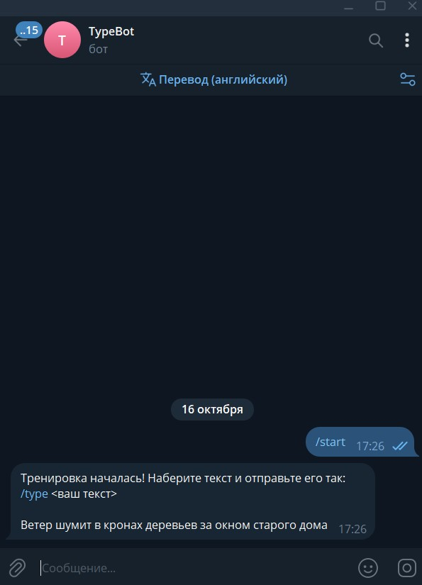
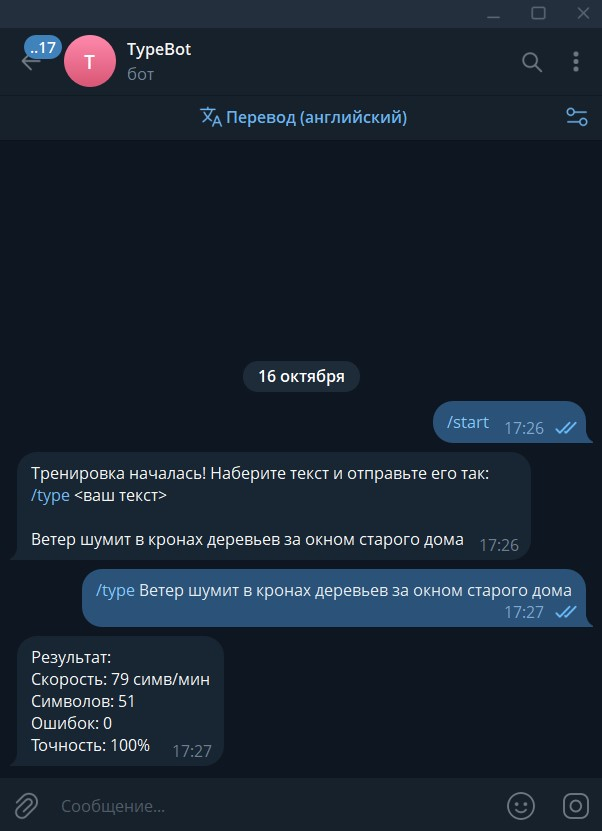
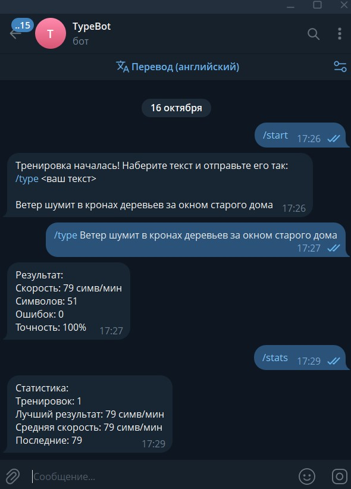

# TypeBot - Telegram-тренажёр машинописи

Telegram-бот для тренировки скорости и точности печати.
Показывает случайный текст, принимает набранный вариант, считает скорость, ошибки и точность, хранит статистику тренировок.

**Бот:** [@ttyyppeebot](https://t.me/ttyyppeebot)

## Возможности

`/start` - начинает тренировку и присылает случайный текст для набора
`/type <текст>` - принимает набранный текст, сравнивает с эталоном, показывает результат
`/stats` - показывает статистику: лучший результат, среднюю скорость, последние тренировки

Результат тренировки включает:

- **Скорость** - символов в минуту 
- **Количество символов** - сколько набрано
- **Число ошибок** - посимвольное сравнение с эталоном
- **Точность** - процент правильно набранных символов

## Установка и запуск

### 1. Клонировать репозиторий

```bash
git clone https://github.com/shhadel/js_6310_labs_2026.git
cd js_6310_labs_2026/lab3-node/solutions/student-26
```

### 2. Установить зависимости
```bash
npm install
```

### 3. Настроить .env
```bash
cp .env.example .env
TELEGRAM_BOT_TOKEN=ваш_токен
```

### 4. Запустить бота
```bash
npm start
```



