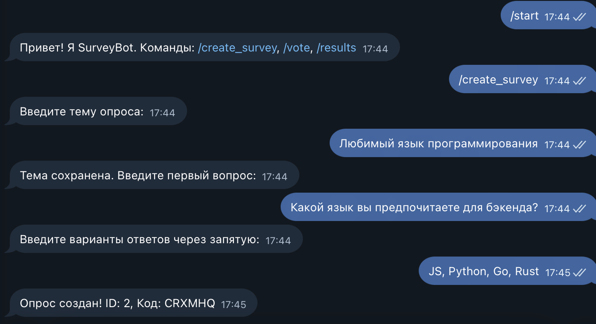
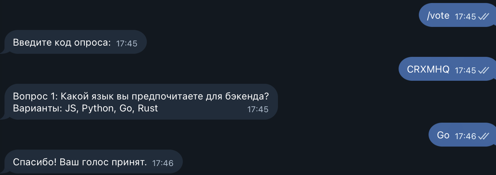
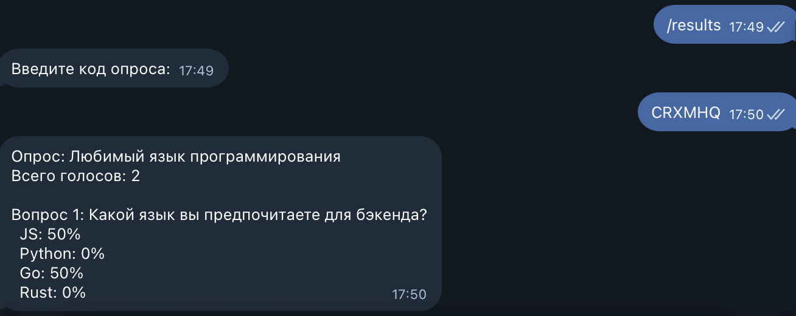

# SurveyBot

Бот для сбора отзывов и голосований с аналитикой. Поддерживает Telegram и ВКонтакте, а также предоставляет REST API для создания опросов и получения результатов.

## Возможности

- Создание опросов через бота или API
- Голосование по короткому коду
- Просмотр результатов с распределением голосов в процентах
- Валидация входных данных на стороне API
- Изоляция состояний разных пользователей

## Стек технологий

- **Node.js** (ES Modules)
- **Telegram Bot API** — библиотека `node-telegram-bot-api`
- **VK API** — библиотека `vk-io`
- **Express** — REST API
- **Jest** — тестирование
- **ESLint** — линтинг

## Установка

```bash
npm install
```

## Настройка

Создайте файл `.env` в корне проекта:

```env
TELEGRAM_BOT_TOKEN=ваш_токен_от_BotFather
VK_GROUP_TOKEN=ваш_токен_группы_ВК
PORT=3000
```

Получить токен Telegram-бота: [@BotFather](https://t.me/BotFather) → `/newbot`.

Токен VK опционален. Если он не задан — VK-бот просто не запустится, а Telegram и API продолжат работать.

## Запуск

```bash
npm start
```

После запуска:

- Telegram-бот начнёт принимать сообщения;
- VK-бот начнёт polling;
- API будет доступен на `http://localhost:3000`.

## Команды бота

 `/start` - Приветствие и список команд 
 `/create_survey` - Создать опрос (тема → вопрос → варианты через запятую) |
 `/vote` - Проголосовать по коду опроса |
 `/results` - Посмотреть результаты по коду опроса |

## API

### Создание опроса

```
POST /api/surveys
Content-Type: application/json

{
  "topic": "Любимый язык программирования",
  "questions": [
    {
      "question": "Какой язык вы предпочитаете для бэкенда?",
      "options": ["JavaScript", "Python", "Go", "Rust"]
    }
  ]
}
```

Ответ:

```json
{ "id": 1, "code": "K8SODQ" }
```

### Получение результатов

```
GET /api/surveys/:id/results
```

Ответ:

```json
{
  "total": 3,
  "distribution": {
    "0": {
      "JavaScript": 33,
      "Python": 33,
      "Go": 33,
      "Rust": 0
    }
  }
}
```

## Скрипты

 `npm start` - Запуск ботов и API 
 `npm run dev` - Запуск с nodemon 
 `npm run lint` - Проверка ESLint 
 `npm run lint:fix` - Автоисправление замечаний ESLint 
 `npm run test` - Запуск тестов 
 `npm run test:coverage` - Запуск тестов с покрытием 

## Примеры работы

### Создание опроса



### Голосование



### Результаты



## Как это работает

- **Конечный автомат (FSM).** Каждая команда (`/create_survey`, `/vote`, `/results`) переводит пользователя в отдельное состояние. Состояние хранится в `Map` по ключу `platform_userId`, поэтому диалоги разных пользователей не пересекаются.
- **Хранилище.** Опросы и голоса хранятся в памяти. При перезапуске приложения состояние сбрасывается — это допустимо по заданию.
- **Коды опросов.** Короткий код генерируется случайно и используется для голосования и просмотра результатов.