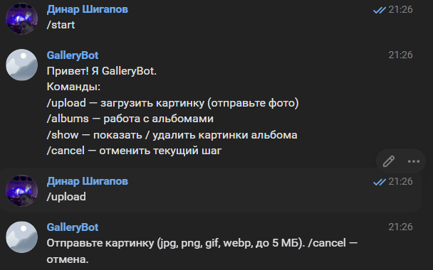
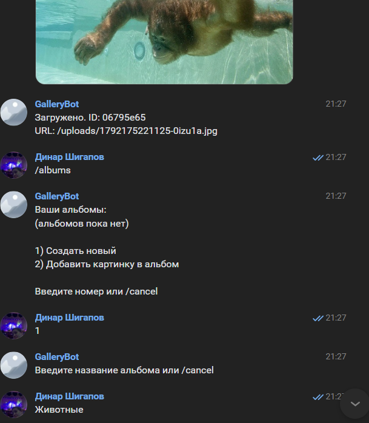
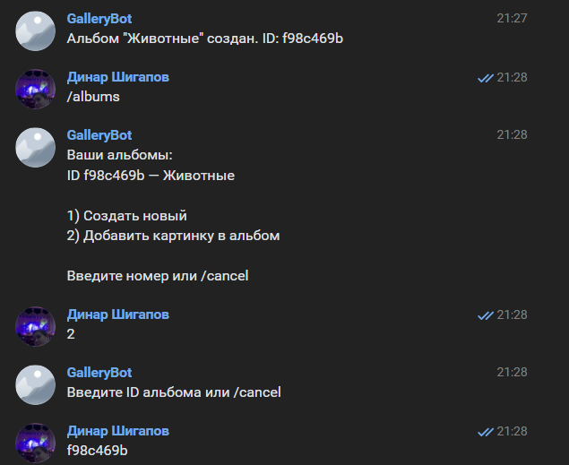
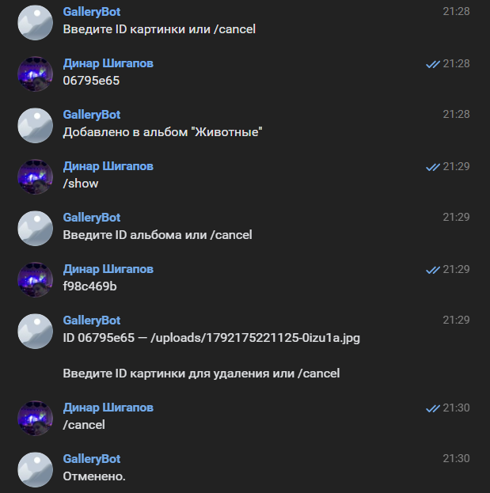

# GalleryBot — лабораторная работа №3 (student-29)

Бот галереи изображений: хостинг картинок, альбомы и REST API.

## Возможности

- **Загрузка изображений** через бота и API.
- **Альбомы**: создание, добавление картинок, просмотр, удаление.
- **Конечный автомат (FSM)** для пошаговых команд.
- **Изоляция состояний** между пользователями — команды разных людей не пересекаются.
- **VK-бот** на `vk-io`.
- **REST API** на `express` + `multer`.
- Сброс состояния при перезапуске (в памяти), сохранение в JSON-файлы (бонус).

## Стек

- Node.js (ESM, `"type": "module"`)
- [express](https://www.npmjs.com/package/express) + [multer](https://www.npmjs.com/package/multer) — REST API
- [vk-io](https://www.npmjs.com/package/vk-io) — VK-бот
- [Jest](https://jestjs.io/) — тесты (coverage ≥ 70%)
- [ESLint](https://eslint.org/) — линт

## Установка и запуск

```bash
git clone <your-fork-url>
cd lab3-node/solutions/student-29
npm install

# скопировать пример переменных окружения
cp .env.example .env
# откройте .env и впишите VK_GROUP_TOKEN

npm run start
```

После запуска:

- API доступно на `http://localhost:3000`
- VK-бот подключается к сообществу и отвечает на сообщения

## Переменные окружения

| Переменная | Описание |
|---|---|
| `VK_GROUP_TOKEN` | Токен сообщества VK с правами на сообщения и Long Poll API |
| `PORT` | Порт API (по умолчанию `3000`) |

## Команды бота

| Команда | Действие |
|---|---|
| `/start` | Приветствие и справка |
| `/upload` | Загрузить картинку, получить ID и URL |
| `/albums` | Список альбомов, создание нового, добавление картинки |
| `/show` | Показать картинки альбома, удалить по ID |
| `/cancel` | Отменить текущий шаг |

### Сценарий работы

1. **Загрузка** — `/upload`, затем отправьте картинку. Бот сохранит её и вернёт ID.
2. **Создание альбома** — `/albums` → `1` → введите название. Бот вернёт ID альбома.
3. **Добавление картинки** — `/albums` → `2` → введите ID альбома → введите ID картинки.
4. **Просмотр и удаление** — `/show` → введите ID альбома → бот покажет список → введите ID картинки для удаления.

## REST API

### `POST /api/images`

Загружает изображение. Формат — `multipart/form-data`, поле `image`.

```bash
curl.exe -X POST http://localhost:3000/api/images -F "image=@cat.jpg"
```

Ответ:

```json
{
  "id": "f29401b4",
  "url": "/uploads/1792171935897-vylbdb.jpg"
}
```

Ошибки:
- `400` — нет файла или недопустимый формат/размер
- Поддерживаются `jpg`, `png`, `gif`, `webp`, до 5 МБ

### `GET /api/albums/:albumId/images`

Возвращает список изображений альбома.

```bash
curl.exe http://localhost:3000/api/albums/6baef170/images
```

Ответ:

```json
[
  {
    "id": "f29401b4",
    "filename": "1792171935897-vylbdb.jpg",
    "url": "/uploads/1792171935897-vylbdb.jpg",
    "mime": "image/jpeg",
    "size": 42315,
    "createdAt": 1792171935897
  }
]
```

Ошибки:
- `404` — альбом не найден

## Скриншоты

### Команды бота







## Тесты

```bash
npm test
npm run test:coverage
```

Покрытие: не ниже 70% по `branches`, `functions`, `lines` — по конфигурации `jest.config.json`.

Тестируются:

- `services/storage.js` — хранилище в памяти
- `services/imageService.js` — валидация и сохранение картинок
- `services/albumService.js` — альбомы
- `fsm/userStates.js` — состояния пользователей
- `handlers/messageHandler.js` — логика команд
- `bots/vkBot.js` — приём сообщений и вложений
- `api/server.js` — HTTP-эндпоинты

