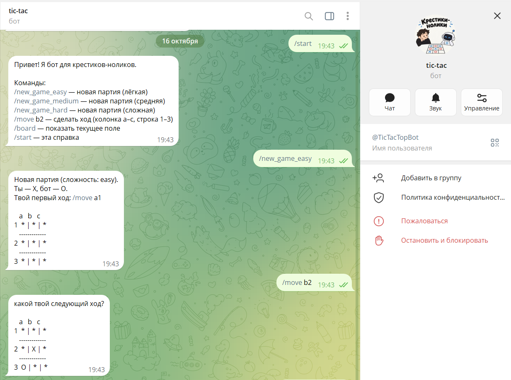
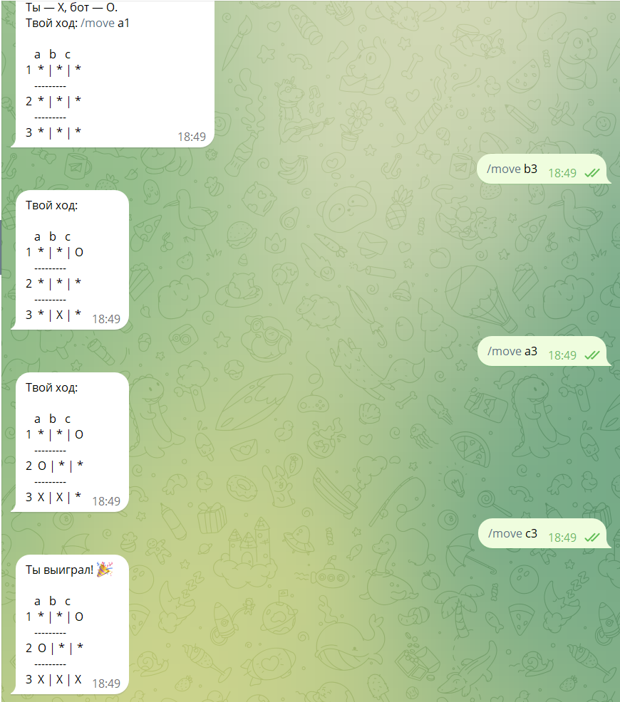
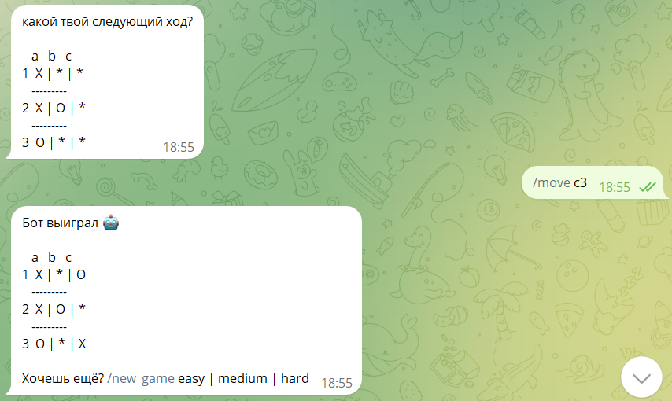

## TicTacBot — Telegram-бот для игры в крестики-нолики

Бот-противник для игры в крестики-нолики с тремя уровнями сложности. Реализует независимые игровые сессии для каждого пользователя и конечный автомат состояний.

## Функциональность

- 🎮 Игра в крестики-нолики через команды в Telegram

- 🎯 Три уровня сложности: easy (случайно), medium (простая эвристика), hard (минимакс)

- 🔄 Независимые игровые сессии для каждого пользователя

- 🏁 Автоматическая проверка победы и ничьей

Откройте бота в Telegram по username и отправьте `/start`.

\## Команды

- `/start` — справка
- `/new_game_easy` — новая партия (лёгкая)
- `/new_game_medium` — новая партия (средняя)
- `/new_game_hard` — новая партия (сложная)
- `/move b2` — сделать ход (колонка a–c, строка 1–3)
- `/board` — показать текущее поле

## Скрины

### Справка /start

## Победа игрока

### Проигрыш — победа бота

