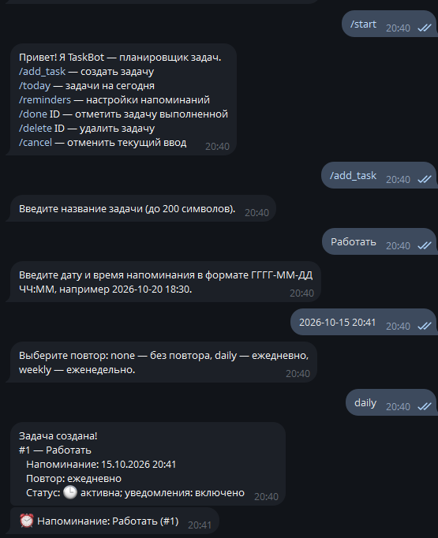
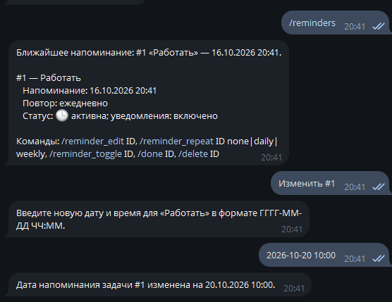

# TaskBot — Telegram-планировщик задач

TaskBot помогает создавать задачи на день, задавать время напоминания, использовать ежедневные и еженедельные повторы и отмечать выполнение. Проект использует Node.js ES Modules и `node-telegram-bot-api`.

## Возможности

- `/add_task` — пошаговое создание задачи: название → дата и время → режим повтора.
- `/today` — задачи, запланированные на текущий календарный день.
- `/reminders` — список задач, статус, дата, повторы, состояние уведомлений и ближайшее активное напоминание.
- `/done ID` — отмечает разовую задачу выполненной; у повторяющейся переносит напоминание на следующий период.
- `/delete ID` — безвозвратно удаляет задачу и её напоминание; также доступно из клавиатуры `/reminders`.
- `/reminder_edit ID` — изменить дату и время.
- `/reminder_repeat ID none|daily|weekly` — изменить повтор.
- `/reminder_toggle ID` — включить или отключить уведомление.
- Планировщик запускается автоматически при старте и проверяет задачи сразу, затем каждые 15 секунд. При ошибке отправки сообщение не считается доставленным и будет повторена попытка при следующей проверке.
- `/cancel` — отменить текущий пошаговый ввод; `/help` — справка.

Каждый пользователь имеет отдельное состояние конечного автомата и отдельный список задач. Некорректные сообщения и даты обрабатываются без аварийного завершения бота.

## Требования

- Node.js 20 или новее
- Telegram-бот, созданный через [@BotFather](https://t.me/BotFather)

## Установка и запуск

1. Установите зависимости:

   ```bash
   npm install
   ```

2. Создайте `.env` на основе `.env.example` и вставьте токен, полученный у BotFather:

   ```env
   TELEGRAM_BOT_TOKEN=ваш_токен
   ```

   Не добавляйте `.env` в Git. В репозитории хранится только шаблон `.env.example`.

3. Запустите бота:

   ```bash
   npm start
   ```

4. Откройте своего бота в Telegram и отправьте `/start`.

## Команды

| Команда | Назначение |
| --- | --- |
| `/add_task` | Создать задачу |
| `/today` | Показать задачи на сегодня |
| `/reminders` | Настройки и список напоминаний |
| `/done 3` | Отметить задачу №3 выполненной |
| `/delete 3` | Удалить задачу №3 |
| `/reminder_edit 3` | Изменить дату/время задачи №3 |
| `/reminder_repeat 3 weekly` | Установить еженедельный повтор |
| `/reminder_toggle 3` | Включить/отключить уведомление |
| `/cancel` | Отменить ввод |

Дата вводится в локальном времени машины, где запущен бот, в формате `ГГГГ-ММ-ДД ЧЧ:ММ`, например `2026-10-20 18:30`. Повтор: `none`, `daily` или `weekly`.


## Примеры работы

