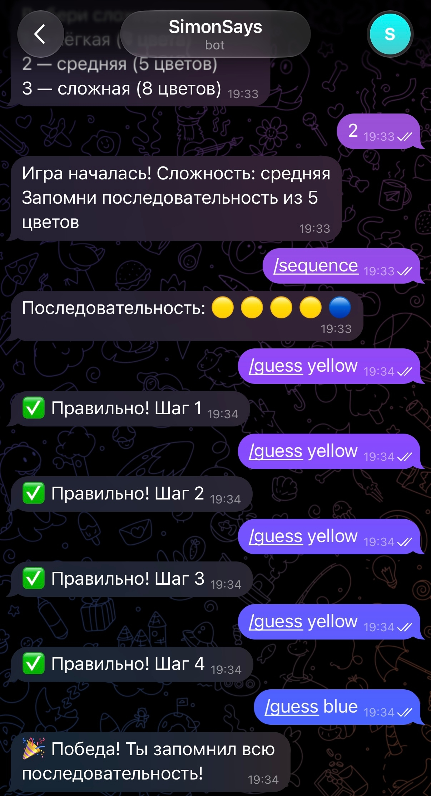
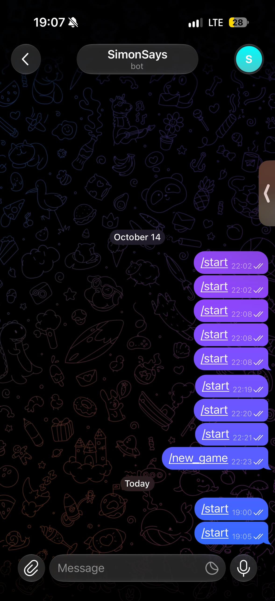

# SimonBot — Помощник по игре «Simon Says»

Учебный Telegram-бот, разработанный в рамках Лабораторной работы №3. Бот помогает игрокам тренировать память в игре «Simon Says»: генерирует последовательности цветов, хранит состояние каждой игры отдельно и проверяет ответы пользователя.

## Команды бота

- `/start` — приветствие и список основных команд
- `/new_game` — запуск новой игры с выбором сложности
- `/sequence` — просмотр текущей последовательности цветов
- `/guess <цвет>` — ответ на текущий шаг последовательности
- `/help` — краткая справка по игре

## Цвета и сложности

**Цвета:** 🔴 `red` · 🟢 `green` · 🔵 `blue` · 🟡 `yellow`

| Сложность | Длина последовательности |
|-----------|--------------------------|
| Лёгкая | 3 цвета |
| Средняя | 5 цветов |
| Сложная | 8 цветов |

## Запуск проекта

1. Установка зависимостей:
   ```bash
   npm install
   ```

2. Создайте файл `.env` на основе `.env.example` и укажите токен Telegram:
   ```env
   TELEGRAM_BOT_TOKEN="ВАШ_ТОКЕН"
   ```

3. Запуск бота:
   ```bash
   npm start
   ```

4. Проверка линтера и тестов:
   ```bash
   npm run lint
   npm run test:coverage
   ```

## Примеры работы






## Структура проекта

```
student-7/
├── src/
│   ├── index.js              ← точка входа
│   ├── bots/
│   │   └── telegramBot.js    ← Telegram-бот
│   ├── handlers/
│   │   └── messageHandler.js ← обработчик команд (FSM)
│   └── game/
│       ├── constants.js      ← цвета, сложности, состояния
│       ├── gameLogic.js      ← логика игры
│       └── gameState.js      ← состояние игр пользователей
├── tests/
│   ├── messageHandler.test.js
│   ├── gameLogic.test.js
│   ├── gameState.test.js
│   └── telegramBot.test.js
├── screenshots/
│   ├── telegram-1.png
│   └── telegram-2.png
├── .env.example
├── .gitignore
├── eslint.config.js
├── jest.config.json
├── package.json
└── README.md
```

## Как играть

1. `/new_game` — начни игру и выбери сложность (1, 2 или 3)
2. `/sequence` — запомни последовательность цветов
3. `/guess red` — повтори цвета **по порядку**
4. Если все цвета угаданы — 🎉 **Победа!**
5. Если ошибся — игра заканчивается, начни заново