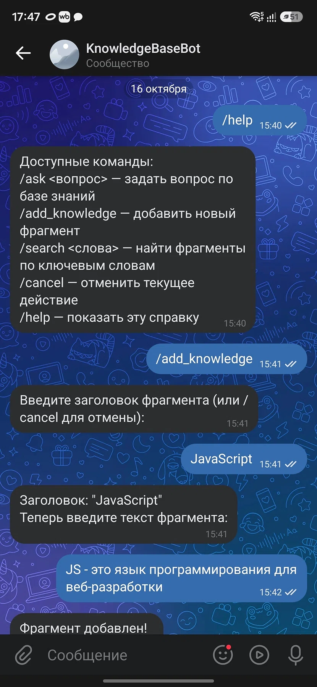
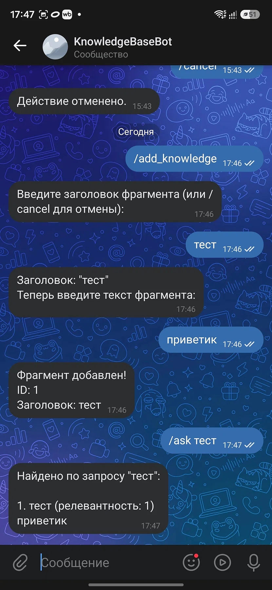
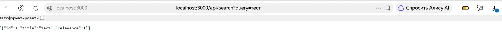

# KnowledgeBaseBot

Бот-ассистент с базой знаний для VK и REST API для работы с ней.

## Описание проекта
Проект представляет собой бота для социальной сети ВКонтакте, который отвечает на вопросы пользователей, опираясь на собственную базу знаний. Также реализован REST API для добавления и поиска фрагментов базы знаний.

## Функциональность
- **VK-бот**:
  - `/ask <вопрос>` — поиск релевантных фрагментов и ответ с контекстом.
  - `/add_knowledge` — пошаговое добавление нового фрагмента (через конечный автомат).
  - `/search <слова>` — поиск фрагментов по ключевым словам с указанием релевантности.
  - `/help` — список команд.
- **API-сервис**:
  - `GET /api/search?query=...` — поиск фрагментов (возвращает `id`, `title`, `relevance`).
  - `POST /api/knowledge` — добавление фрагмента (`title`, `content`).

## Технологии
- Node.js (ES6 Modules)
- VK-IO (для работы с VK API)
- Express (для API)
- Jest (тестирование)
- ESLint (линтер)

## Инструкция по запуску
1. Установите все зависимости командой: npm install

2. Создайте файл .env в корневой папке проекта на основе файла .env.example и заполните его своими данными:
VK_GROUP_TOKEN = 'ваш_токен_сообщества'
VK_GROUP_ID = 'id_вашего_сообщества'
PORT = 3000

3. Запустите проект командой: npm start
После запуска API будет доступно по адресу http://localhost:3000, а бот начнет отвечать на сообщения в VK.

4. Для проверки тестов и покрытия кода используйте команды:
npm test
npm run test:coverage

5. Для проверки линтера используйте команду: npm run lint

## Пример работы
1. Добавление фрагмента базы знаний через бота
Пользователь вводит /add_knowledge, бот запрашивает заголовок, затем текст. Фрагмент успешно сохраняется в базе.

2. Поиск через бота
Пользователь задает вопрос через команду /ask. Бот находит нужный фрагмент и выводит его с указанием релевантности.

3. Работа API-сервиса
Пример GET-запроса к API через браузер. Возвращается JSON-массив с найденными фрагментами.

