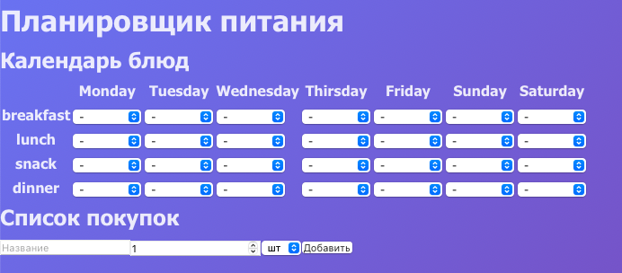
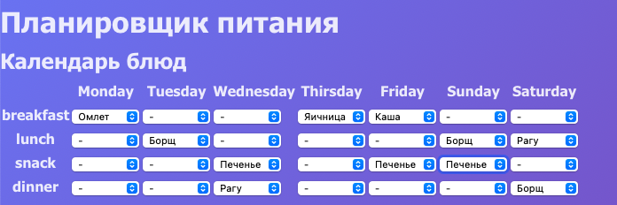
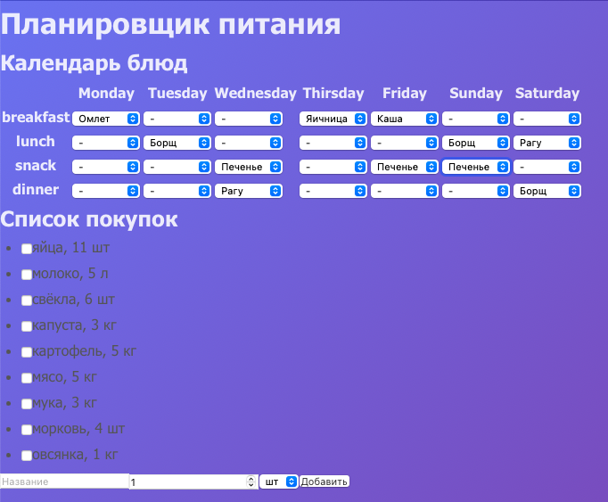
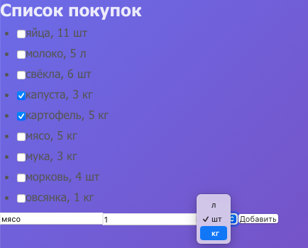

# Лабораторная работа 4. React: планировщик питания

Два совместимых проекта на React + TypeScript:

- **ui-library**: библиотека компонентов (`MealCalendar`, `ShoppingList`, а также `Button` и `Card`), без сторонних UI-библиотек.
- **frontend**: приложение, которое использует библиотеку как пакет `@my-app/ui-library`.

Студент: <ФИО>, вариант 10, группа <группа>.

## Компоненты

### Календарь блюд (`MealCalendar`)
Сетка «дни недели × приёмы пищи». Для каждого слота можно выбрать блюдо из списка или снять выбор (пункт «-»).

| Свойство | Тип | Описание |
|---|---|---|
| `day` | `Day[]` | Дни недели |
| `eating` | `Eating[]` | Приёмы пищи |
| `meal` | `Meal[]` | Доступные блюда |
| `selected` | `Record<string, Meal>` | Выбранные блюда, ключ `день-приём` |
| `choice` | `(day, eating, meal \| null) => void` | Вызывается при выборе блюда |

### Список покупок (`ShoppingList`)
Собирает ингредиенты выбранных блюд, складывает одинаковые (одинаковое название и единица измерения), позволяет отмечать купленное и добавлять позиции вручную.

| Свойство | Тип | Описание |
|---|---|---|
| `meals` | `Meal[]` | Блюда, из которых собирается список |
| `bought` | `string[]` | Ключи купленных позиций (`название-единица`) |
| `onToggle` | `(key: string) => void` | Отметка или снятие отметки «куплено» |
| `onAdd` | `(name, amount, unit) => void` | Ручное добавление позиции |

Единицы измерения: `л`, `шт`, `кг`.

## Запуск

Сначала нужно собрать библиотеку, потому что `frontend` использует её сборку.

```bash
# 1. Библиотека
cd ui-library
npm install
npm run build

# 2. Приложение
cd ../frontend
npm install
npm run dev
```

После `npm run dev` приложение открывается по адресу, который выведет Vite (обычно http://localhost:5173).

## Тесты и проверки

В каждом из проектов:

```bash
npm run lint            # проверка кода
npm run build           # сборка
npm test                # тесты
npm run test:coverage   # тесты с отчётом о покрытии
```

Покрытие `ShoppingList.tsx`: не ниже 90% по всем показателям.

## Скриншоты

### Календарь пустой


### Календарь заполненный


### Список покупок с суммированием
Одинаковые ингредиенты разных блюд объединяются (например, яйца из омлета и яичницы дают «яйца, 5 шт»).



### Отмеченная позиция и Ручное добавление

