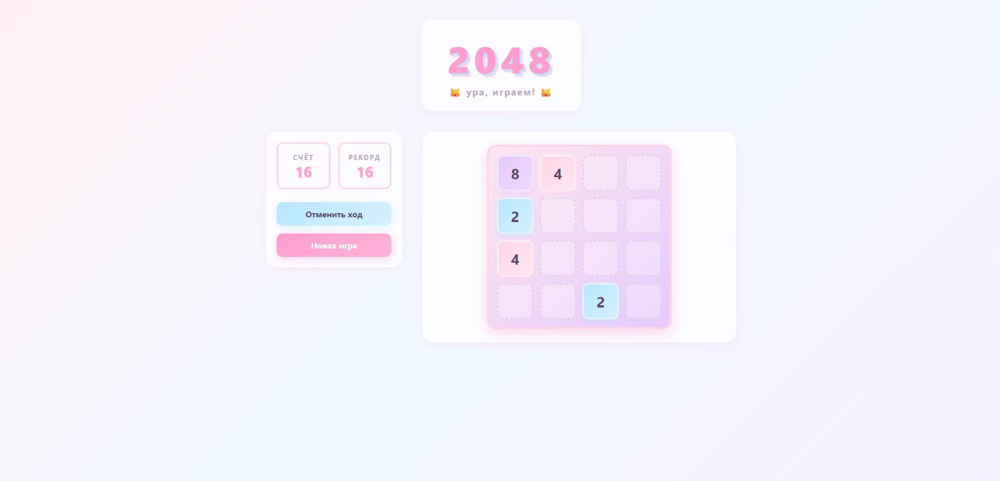

# Лабораторная работа №4 — Игра 2048

## 👩‍💻 Студент: 11

---

## 📋 Описание

Веб-приложение классической игры **2048**, разработанное с использованием собственной UI-библиотеки компонентов на **React + TypeScript + Vite**.

Проект состоит из двух частей:
- **`ui-library`** — библиотека переиспользуемых UI-компонентов с полным покрытием тестами.
- **`frontend`** — приложение-демонстрация, реализующее логику игры 2048 с использованием компонентов библиотеки.

---

## 🧩 Реализованные компоненты (ui-library)

### `Tile`
Отдельная плитка игрового поля. Цвет плитки динамически меняется в зависимости от её числового значения (2, 4, 8, ..., 2048). Пустые плитки отображаются полупрозрачными.

**Props:**
- `value: number` — значение плитки (0 = пустая)

### `GameBoard`
Игровое поле 4×4, принимающее двумерный массив чисел и рендерящее сетку из компонентов `Tile`.

**Props:**
- `grid: Grid` — двумерный массив 4×4 с числами

### `ScorePanel`
Панель управления игрой: отображает текущий счёт, рекорд и содержит кнопки «Отменить ход» и «Новая игра».

**Props:**
- `score: number` — текущий счёт
- `highScore: number` — рекорд
- `onNewGame: () => void` — обработчик новой игры
- `onUndo: () => void` — обработчик отмены хода

---

## 🎮 Функциональность игры

- ✅ Полноценная логика 2048 (движение плиток во всех 4 направлениях: ← ↑ → ↓)
- ✅ Слияние плиток с одинаковыми значениями
- ✅ Подсчёт очков и отслеживание рекорда
- ✅ Отмена последнего хода с корректным уменьшением счёта
- ✅ Определение состояния проигрыша (нет доступных ходов)
- ✅ Экран «Вы проиграли!» с кнопкой новой игры
- ✅ Блокировка прокрутки страницы при нажатии стрелок
- ✅ Пастельный дизайн с котятной тематикой 🐱

---

## 🛠 Технологии

- **React 19** + **TypeScript** (строгая типизация)
- **Vite** (сборка и dev-сервер)
- **Jest** + **Testing Library** (тестирование)
- **ESLint** (линтинг кода)
- **CSS Modules** (изоляция стилей компонентов)

---

## 🚀 Инструкция по запуску

### 1. Установка зависимостей

```bash
# В папке ui-library
cd ui-library
npm install

# В папке frontend
cd ../frontend
npm install
```

### 2. Сборка библиотеки

Перед запуском frontend необходимо собрать ui-library, чтобы появились типы и JS-файлы:

```bash
cd ui-library
npm run build
```

### 3. Запуск приложения в режиме разработки

```bash
cd frontend
npm run dev
```

Приложение будет доступно по адресу: **http://localhost:5173**

### 4. Сборка для продакшена

```bash
cd frontend
npm run build
```

Результат сборки появится в папке `frontend/dist/`.

---

## 🧪 Тестирование

Запуск тестов с отчётом о покрытии:

```bash
cd ui-library
npm run test:coverage
```

### Результаты покрытия

| Компонент       | Stmts | Branch | Funcs | Lines |
|-----------------|-------|--------|-------|-------|
| **GameBoard**   | 100%  | 100%   | 100%  | 100%  |
| **ScorePanel**  | 100%  | 100%   | 100%  | 100%  |
| **Tile**        | 100%  | 100%   | 100%  | 100%  |
| Button          | 100%  | 100%   | 100%  | 100%  |

> Все разработанные компоненты имеют **100% покрытие** по всем метрикам (Stmts, Branch, Funcs, Lines), что превышает требование лабы в 90%.

---

## 📸 Скриншоты



---

## 📝 Примечания

- Для управления игрой используйте стрелки клавиатуры: **← ↑ → ↓**
- Кнопка **«Отменить ход»** возвращает поле и счёт к состоянию до последнего хода
- Кнопка **«Новая игра»** сбрасывает счёт, рекорд и историю ходов
- При отсутствии доступных ходов появляется экран проигрыша с предложением начать заново

---