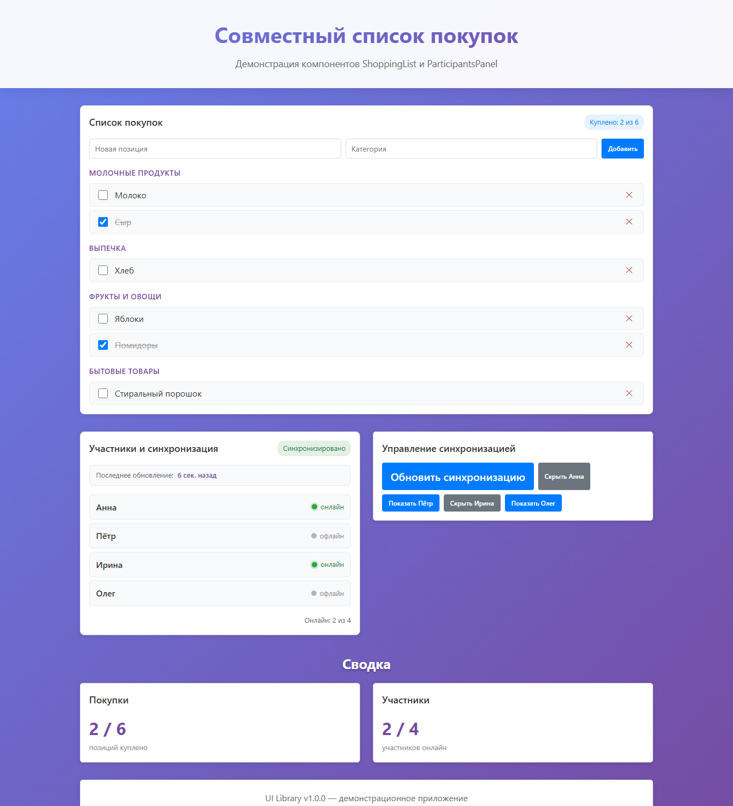
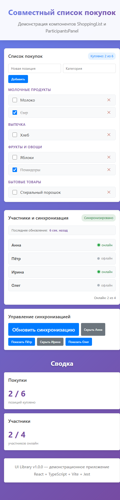

# Лабораторная работа №4 — UI-библиотека и демонстрационное приложение (вариант 15)

Проект состоит из двух независимых npm-пакетов на TypeScript:

- **`ui-library`** — библиотека UI-компонентов (React + Vite + Jest);
- **`frontend`** — презентационное приложение, демонстрирующее работу компонентов библиотеки.

## Задание (вариант 15)

Разработать компоненты:

1. **Список покупок** — позиции с чекбоксами, группировка по категориям, добавление и удаление позиции.
2. **Панель участников и синхронизации** — список участников с признаком «онлайн», индикатор времени последнего обновления.

Сторонние UI-библиотеки не используются — все компоненты написаны самостоятельно.

## Компоненты библиотеки

| Компонент | Возможности |
| --- | --- |
| `ShoppingList` | чекбоксы, группировка позиций по категориям, добавление позиции с выбором категории, удаление позиции, счётчик купленного |
| `ParticipantsPanel` | список участников с индикатором «онлайн/офлайн», счётчик участников онлайн, индикатор времени последнего обновления в реальном времени |

Дополнительно в библиотеке есть базовые компоненты `Button` и `Card`, которые используются компонентами и приложением.

## Структура

```
solutions/student-15/
├── ui-library/          # библиотека компонентов
│   └── src/
│       ├── Button/
│       ├── Card/
│       ├── ShoppingList/
│       ├── ParticipantsPanel/
│       ├── utils/
│       └── index.ts
├── frontend/            # демонстрационное приложение
│   └── src/
│       ├── App.tsx
│       └── main.tsx
├── screenshots/         # скриншоты работы приложения
└── README.md
```

## Требования

- Node.js 20+ и npm.

## Запуск

### 1. Библиотека компонентов

```sh
cd ui-library
npm install
npm run build        # сборка библиотеки в папку dist
npm run dev          # сборка в режиме наблюдения
npm run lint         # проверка ESLint
npm test             # запуск тестов
npm run test:coverage
```

### 2. Демонстрационное приложение

Перед первым запуском приложения необходимо собрать библиотеку (см. пункт 1), так как приложение подключает её как локальную зависимость (`file:../ui-library`).

```sh
cd frontend
npm install
npm run dev          # http://localhost:5173
npm run build        # production-сборка
npm run lint
npm test
npm run test:coverage
```

## Скриншоты

Общий вид приложения (десктоп):



Адаптивный вид (мобильный):



## Технологии

- React 19, TypeScript, Vite;
- Jest + Testing Library;
- ESLint (плоский конфиг, 2 пробела, без `;`, сортировка импортов);
- покрытие тестами компонентов `ShoppingList` и `ParticipantsPanel` — 100% по всем столбцам.
