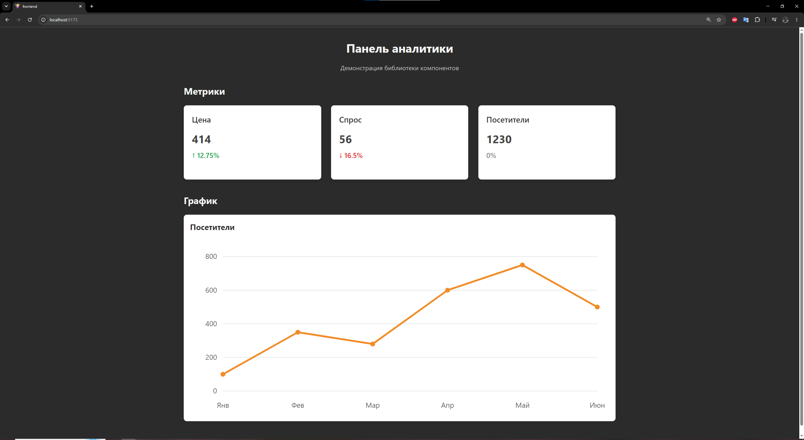

# Лабораторная работа №4 — React и TypeScript

## Описание

Разработана UI-библиотека компонентов на React и TypeScript, а также демонстрационное приложение для проверки её работы.

## Компоненты библиотеки

- **MetricCard** — карточка метрики с названием, значением и процентом изменения. Поддерживает отображение роста, снижения и отсутствия изменений.
- **Chart** — линейный график на SVG с подписями, точками данных и шкалой значений.

## Структура проекта

- `ui-library/` — UI-библиотека компонентов.
- `frontend/` — демонстрационное приложение.
- `images/` — скриншот приложения.

## Запуск

В каждом проекте предварительно установите зависимости:

```bash
npm install
```

Запуск библиотеки:

```bash
cd ui-library
npm run build
```

Запуск демонстрационного приложения:

```bash
cd frontend
npm run dev
```

## Проверка

В обоих проектах доступны команды:

```bash
npm run lint
npm run lint:fix
npm test
npm run test:coverage
npm run build
```

## Скриншоты

### Демонстрационное приложение



