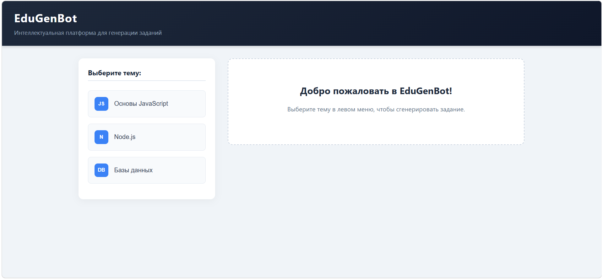
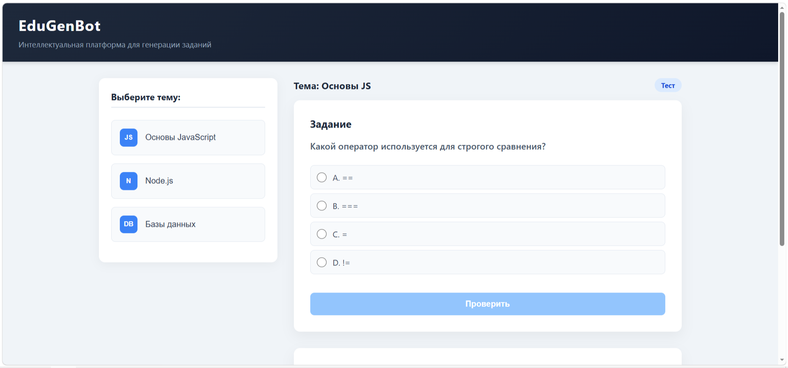
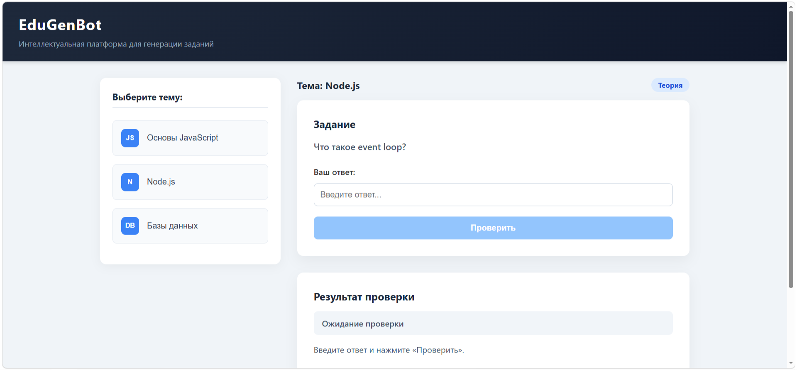
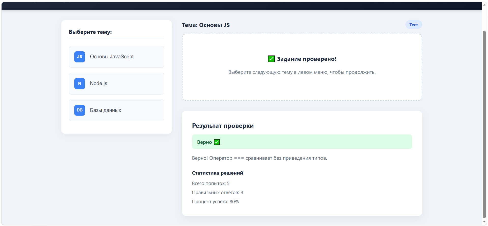

# Лабораторная работа №4: UI-библиотека и приложение EduGenBot

Данный проект является продолжением Лабораторной работы №3. В рамках работы была создана переиспользуемая библиотека UI-компонентов на React и демонстрационное веб-приложение, имитирующее панель управления образовательного бота **EduGenBot**.

## Состав проекта

Проект разделен на две независимые части:
1. **ui-library** — библиотека UI-компонентов.
2. **frontend** — демонстрационное приложение, использующее компоненты из библиотеки.

### Разработанные компоненты:
*   **TaskCard (Карточка задания)** — отображает условие задания, поддерживает как ввод текстового ответа (для теоретических вопросов), так и выбор из вариантов (для тестов). Имеет кнопку проверки.
*   **ResultPanel (Панель результата)** — отображает статус проверки (Ожидание / Верно / Неверно), текстовое пояснение к ответу и статистику решений (всего попыток, правильных ответов, процент успеха).

## Технологии
*   React 19
*   TypeScript
*   Vite
*   Jest + React Testing Library (для тестирования)
*   ESLint (для проверки качества кода)

---

## 🚀 Инструкция по запуску

Для запуска проекта вам понадобятся **Node.js** (версия 18 или выше) и **npm**. Все команды выполняются в терминале **PowerShell** (или командной строке Windows).

### Шаг 1: Сборка библиотеки компонентов
Сначала необходимо установить зависимости для библиотеки и собрать её. Это нужно для того, чтобы демонстрационное приложение могло корректно импортировать готовые компоненты.

```powershell
cd ui-library
npm install
npm run build
```

### Шаг 2: Запуск демонстрационного приложения
После сборки библиотеки откройте новый терминал (или вернитесь в корень проекта) и перейдите в папку с приложением. Установите его зависимости и запустите локальный сервер разработки.

```powershell
cd frontend
npm install
npm run dev
```

После выполнения команды `npm run dev` в терминале появится локальная ссылка (обычно **http://localhost:5173**). Откройте её в любом браузере, чтобы увидеть работу приложения.

---

## 🧪 Проверка кода и тесты

В обоих проектах настроены скрипты для проверки кода линтером и запуска тестов.

**В папке `ui-library`:**

```powershell
npm run lint          # Проверка стиля кода
npm run test          # Запуск тестов
npm run test:coverage # Запуск тестов с отчетом о покрытии
```

**В папке `frontend`:**

```powershell
npm run lint
npm run test
```

*Примечание: Покрытие кода тестами для компонентов `TaskCard` и `ResultPanel` составляет более 90% по всем столбцам.*

---

## 📸 Скриншоты работы приложения

Ниже представлены примеры работы демонстрационного приложения:

### 1. Главный экран (Панель управления EduGenBot)


### 2. Задание в виде теста (с вариантами ответов)


### 3. Теоретическое задание и результат проверки


### 4. Статистика
