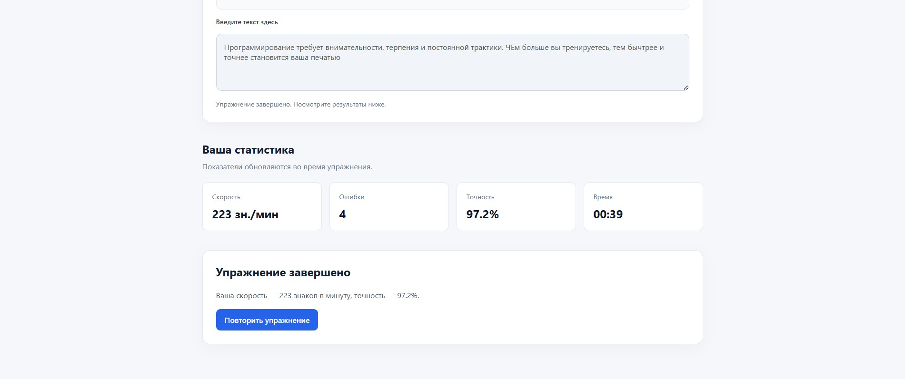

# Вариант 26

## Возможности

- Отображение текста-образца для тренировки печати.
- Подсветка правильно введённых символов и ошибок.
- Подсчёт скорости печати в знаках в минуту.
- Подсчёт ошибок и вычисление точности.
- Отображение времени выполнения упражнения.
- Сброс упражнения и повторное прохождение.

## Компоненты библиотеки

### TypingArea

Компонент для отображения текста-образца и ввода текста.

### StatisticsPanel

Компонент для отображения статистики упражнения.

## Установка и запуск

Сначала соберите библиотеку:

```bash
cd ui-library
npm install
npm run build
```

Затем установите зависимости и запустите приложение:

```bash
cd ../frontend
npm install
npm run dev
```

## Тестирование библиотеки

Из каталога `ui-library`:

```bash
npm test
npm run lint
npm run test:coverage
npm run build
```

## Тестирование приложения

Из каталога `frontend`:

```bash
npm test
npm run lint
npm run build
```

## Скриншот приложения


