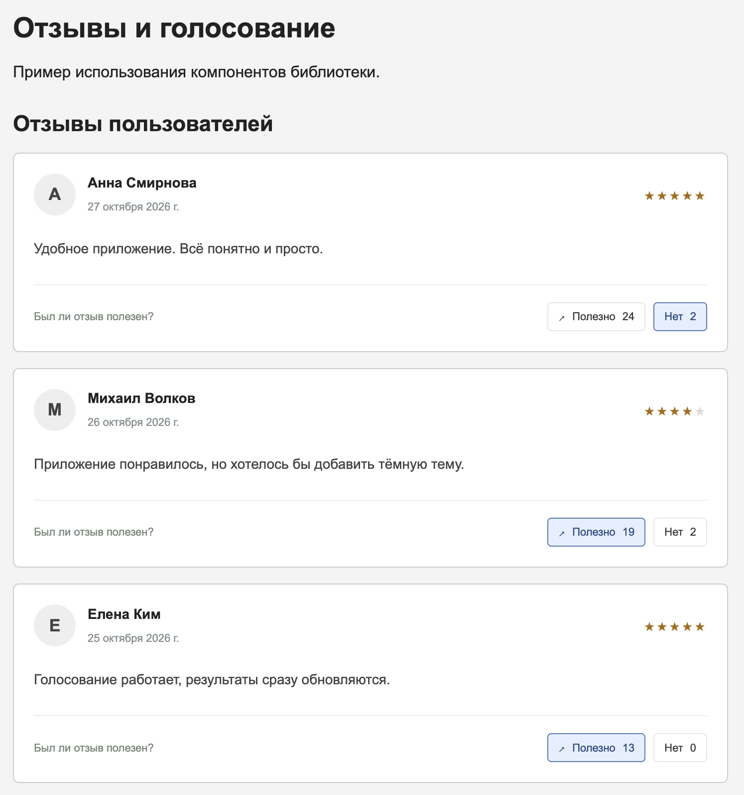
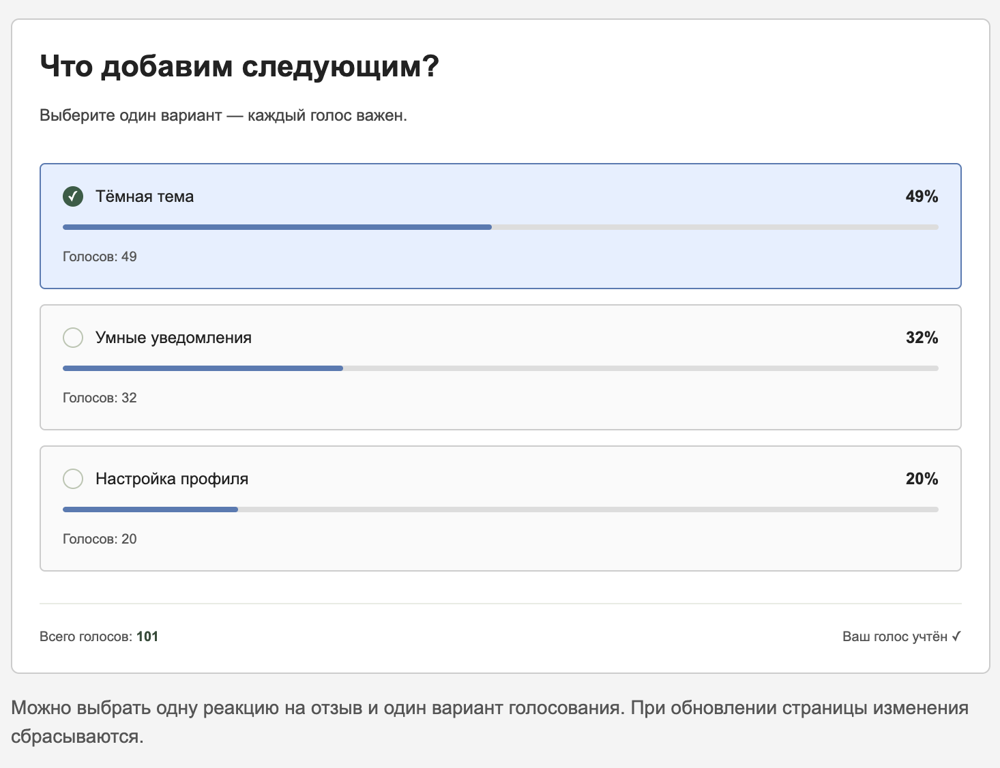

# Отзывы и голосование

Лабораторная работа №4, задание №27.

Проект содержит библиотеку UI-компонентов и React-приложение
с примерами их использования.

## Структура проекта

- `ui-library` — библиотека компонентов.
- `frontend` — демонстрационное приложение.
- `images` — скриншоты приложения.

## Используемые технологии

- React
- TypeScript
- Vite
- Jest и React Testing Library
- ESLint

Сторонние UI-библиотеки не используются.

## Компоненты

### Карточка отзыва — ReviewCard

Показывает:

- автора отзыва;
- текст;
- дату;
- рейтинг;
- количество реакций «Полезно» и «Нет».

Выбранная реакция передаётся через колбэк `onReaction`.
В демонстрационном приложении реакцию можно поставить,
снять повторным нажатием или заменить другой.

### Голосование — Voting

Показывает:

- варианты ответа;
- количество голосов за каждый вариант;
- долю голосов в процентах;
- общее количество голосов.

Выбор варианта передаётся через колбэк `onVote`.
В демонстрационном приложении после голосования
повторный выбор блокируется.

Проценты округляются независимо, поэтому их сумма
может немного отличаться от 100%.
Если голосов нет, показывается 0%.

## Установка и запуск

Из корня репозитория перейдите в библиотеку:

```bash
cd lab4-react/solutions/student-27/ui-library
npm ci
npm run build
```

Затем установите зависимости и запустите приложение:

```bash
cd ../frontend
npm ci
npm run dev
```

Откройте в браузере адрес, который напечатает Vite.

Библиотеку необходимо собрать до запуска приложения.

Для автоматической пересборки при изменении компонентов
в отдельном терминале выполните в папке `ui-library`:

```bash
npm run dev
```

## Проверка проекта

Следующие команды выполняются отдельно в `ui-library`
и отдельно во `frontend`.

Проверка стиля кода:

```bash
npm run lint
```

Автоматическое исправление форматирования:

```bash
npm run lint:fix
```

Запуск тестов:

```bash
npm test -- --runInBand
```

Запуск тестов с отчётом о покрытии:

```bash
npm run test:coverage -- --runInBand
```

Сборка:

```bash
npm run build
```

Порядок сборки: сначала `ui-library`, затем `frontend`.

В Jest установлен порог покрытия 90% по statements,
branches, functions и lines.

Тесты проверяют отображение данных, вызовы колбэков,
реакции на отзывы, изменение результатов голосования
и обработку пограничных случаев.

## Особенности работы

Состояние приложения хранится в памяти React.

После обновления страницы реакции и результаты
возвращаются к исходным значениям.

Бэкенд и база данных не используются.
Ограничение повторного голосования действует только
в рамках текущей загрузки страницы.

Кнопки поддерживают управление с клавиатуры
и показывают выбранное состояние.

## Скриншоты





