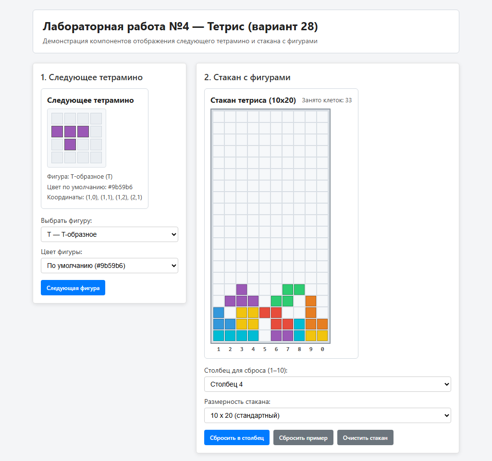
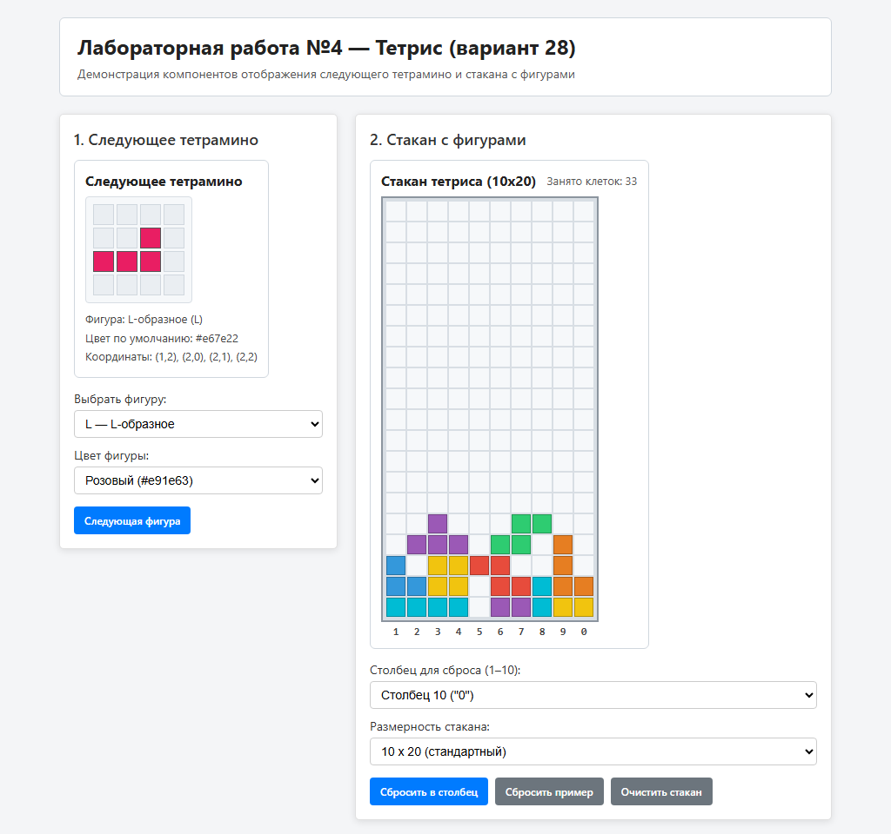
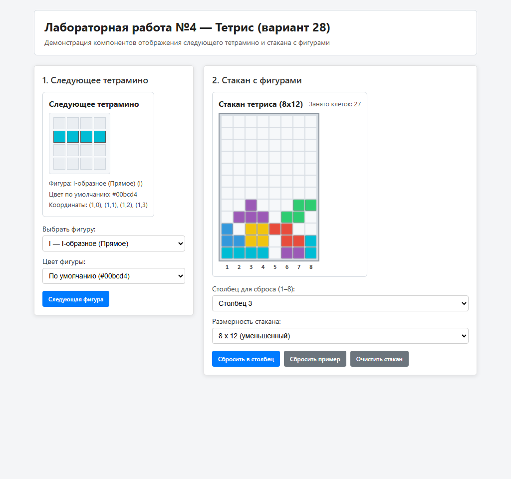

# Лабораторная работа №4 — Компоненты Тетриса (вариант 28)

Учебный проект лабораторной работы №4: библиотека UI-компонентов и демонстрационное приложение на React + TypeScript.

## Описание проекта

Решение состоит из двух проектов:

- **`ui-library`** — библиотека UI-компонентов:
  - `NextTetromino` — отображение следующего тетрамино (принимает объект тетрамино с координатами в сетке и цветом по умолчанию);
  - `TetrisWell` — отображение стакана с заполненными фигурами (принимает заданную размерность тетриса и двумерный массив чисел, где каждое число задаёт цвет ячейки);
  - `Button` и `Card` — базовые компоненты из шаблона.
- **`frontend`** — демонстрационное приложение, где можно переключать фигуры тетриса (`I`, `O`, `T`, `S`, `Z`, `J`, `L`), менять цвет отображения, выбирать размерность стакана (`10x20` или `8x12`) и добавлять фигуры в стакан.

## Скриншоты работы приложения

### 1. Общий вид приложения


### 2. Выбор другой фигуры и смена цвета


### 3. Уменьшенная размерность стакана (8x12)


## Инструкция по запуску

### 1. Сборка библиотеки компонентов (`ui-library`)

```sh
cd lab4-react/solutions/student-28/ui-library
npm install
npm run build
```

### 2. Запуск демонстрационного приложения (`frontend`)

```sh
cd ../frontend
npm install
npm run dev
```

После запуска приложение доступно по адресу `http://localhost:5173`.

## Скрипты

В обоих проектах доступны команды:

- `npm run dev` — запуск в режиме разработки
- `npm run build` — сборка проекта
- `npm run lint` — проверка кода ESLint
- `npm run lint:fix` — автоисправление ESLint
- `npm test` — запуск тестов
- `npm run test:coverage` — запуск тестов с отчётом покрытия
