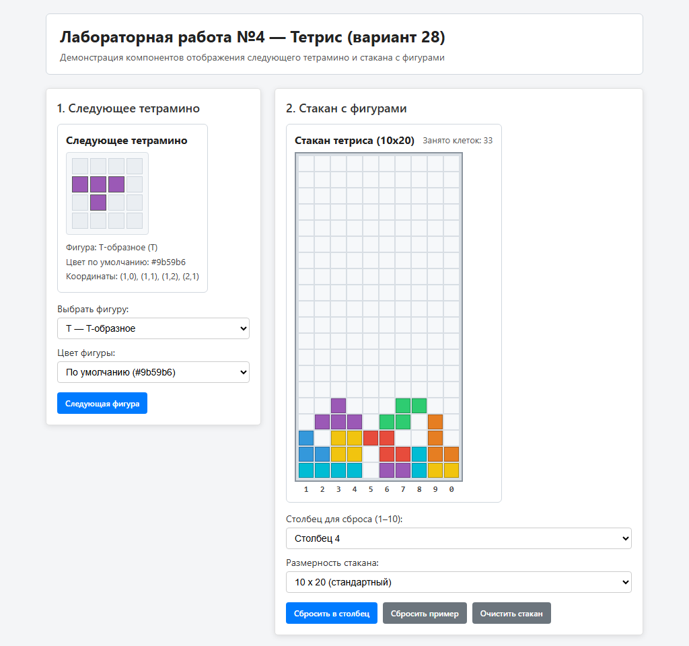

# Tetris UI Studio — Frontend

Демонстрационное веб-приложение на React + TypeScript, использующее компоненты `NextTetromino` и `TetrisWell` из библиотеки `@my-app/ui-library`.



## Запуск проекта

Сначала соберите библиотеку компонентов:

```sh
cd ../ui-library
npm install
npm run build
```

Затем запустите фронтенд-приложение:

```sh
cd ../frontend
npm install
npm run dev
```

## Проверка качества кода и тесты

```sh
npm run lint
npm run test:coverage
npm run build
```

Подробная документация и скриншоты приведены в [корневом README.md](../README.md).
