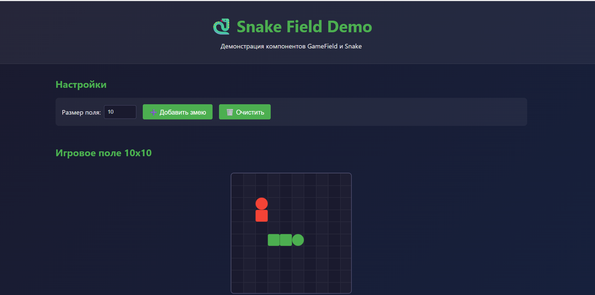
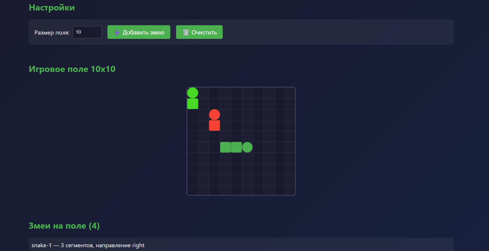

# Лабораторная работа 4: Библиотека UI-компонентов «Змейка»

Решение состоит из двух проектов:
1. **`ui-library`** — библиотека React-компонентов для игры «Змейка».
2. **`frontend`** — демонстрационное веб-приложение, использующее эту библиотеку.

## Компоненты

### `GameField` (Поле для игры)
- Принимает размер сетки (`size`) и список змей (`snakes`).
- Рисует игровое поле `size × size` клеток.
- Отображает на поле всех переданных змей.

### `Snake` (Змея)
- «Знает» своё расположение (`segments` — массив координат).
- Принимает направление (`direction`: `up`, `down`, `left`, `right`).
- Принимает цвет (`color`) и размер клетки (`cellSize`).
- Отображается на поле в соответствии с координатами.

## Технологии
- **TypeScript** (без `any`)
- **React 19**
- **Vite** (сборка и dev-сервер)
- **Jest + Testing Library** (тесты)
- **ESLint** (линтер)
- **CSS Modules** (стили)

Сторонние UI-библиотеки **не используются**.

## Примеры работы

### Главный экран

### Несколько змей на поле

## Установка и запуск

### 1. Собрать библиотеку компонентов

cd ui-library

npm install

npm run build

### 2. Запуск демо-приложения

cd ../frontend

npm install

npm run dev