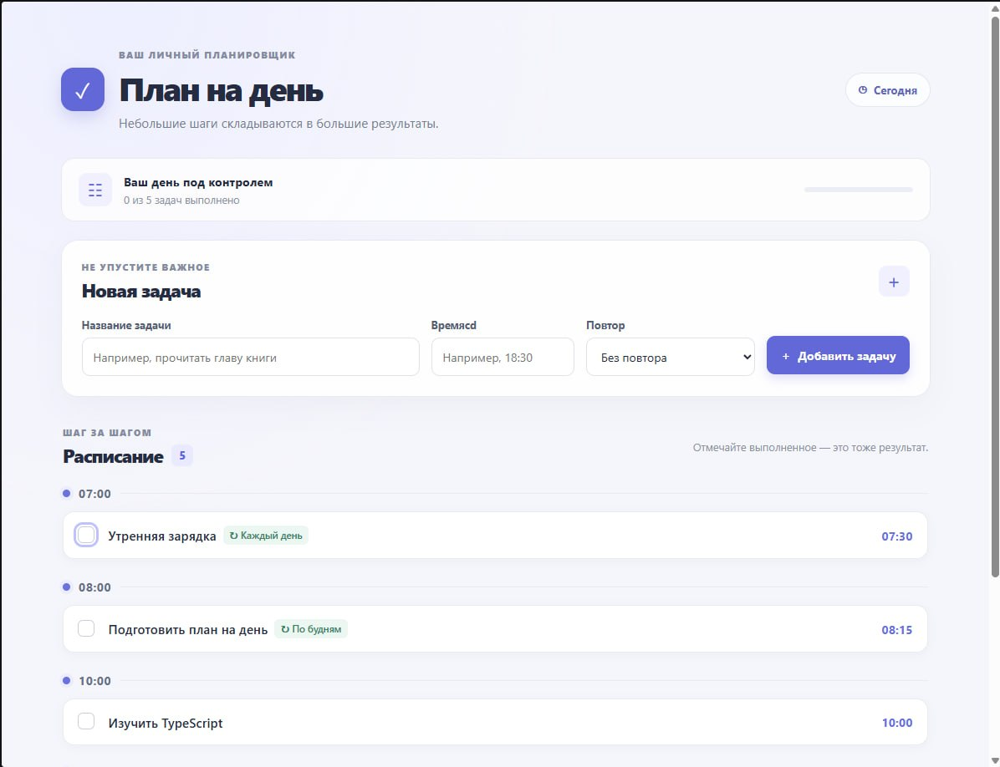
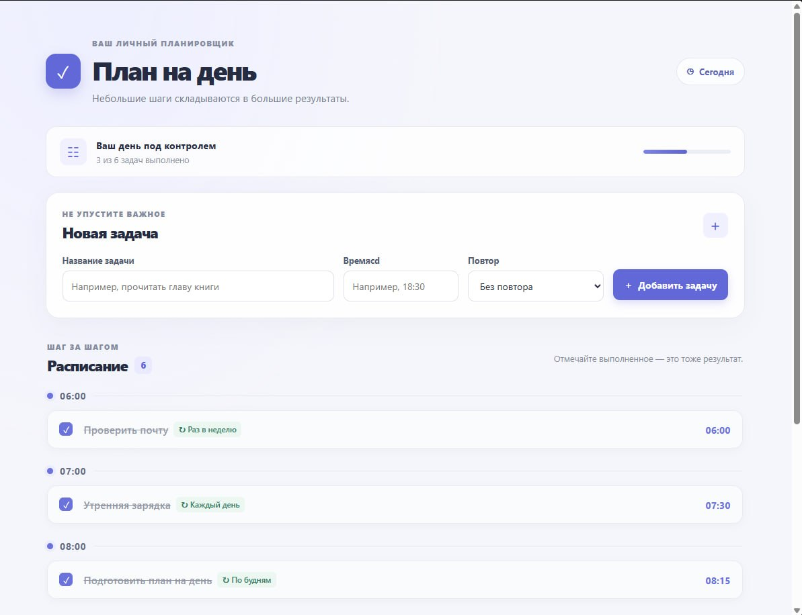

# Планировщик ежедневных задач — React UI Library + Frontend

Проект оформлен по структуре учебного примера из `example.zip`: два отдельных пакета `ui-library` и `frontend`, ES-модули (`type: module`), Vite, TypeScript, ESLint flat config и Jest с `ts-jest` и Testing Library. Версии и основные конфигурации перенесены из учебного примера; названия пакетов и компоненты адаптированы под задание.

## Структура

- `ui-library/` — библиотека компонентов `TaskList` и `TaskForm`, типы, стили и unit-тесты.
- `frontend/` — демонстрационное React-приложение, использующее библиотеку через локальную зависимость `file:../ui-library`.

## Возможности

- список задач сгруппирован по времени и отсортирован по возрастанию;
- отметка выполнения задачи через checkbox;
- отображение режима повтора и пустого состояния;
- форма с названием, временем и режимом повторения;
- русскоязычная проверка обязательных полей;
- состояние и идентификаторы задач хранятся в демонстрационном приложении.

## Запуск

Требуется Node.js, совместимый с указанными версиями зависимостей, и npm. Выполняйте команды из каталога соответствующего пакета.

### 1. Установить зависимости библиотеки

```bash
cd ui-library
npm install
npm run lint
npm test
npm run test:coverage
npm run build
```

### 2. Установить зависимости приложения и запустить

```bash
cd ../frontend
npm install
npm run lint
npm test
npm run test:coverage
npm run dev
```

Откройте локальный адрес Vite, который появится в терминале. Для production-сборки приложения используйте `npm run build`.

## Тестирование

Тесты используют Jest, `jest-environment-jsdom`, `ts-jest` и React Testing Library, как в учебном примере. В Jest-конфигурации `frontend` импорт `@my-app/ui-library` направляется на исходный код `ui-library/src/index.ts`, поэтому тесты frontend можно запускать до сборки библиотеки. Для отчёта о покрытии используйте `npm run test:coverage`. Для `TaskList` в Jest-конфигурации установлен порог не менее 90% по statements, branches, functions и lines. Фактическое прохождение порога нужно подтвердить запуском `npm run test:coverage` после установки зависимостей.

## Скриншоты
Начальное состояние


Состояние выбора (checkbox)


### Тестирование frontend

В `frontend/jest.config.ts` исходники `ui-library` подключаются напрямую для тестов. Алиасы `react`, `react-dom` и JSX runtime направлены на экземпляры React из `frontend/node_modules`, чтобы избежать ошибки `Invalid hook call` из-за двух копий React. Для запуска приложения в браузере сначала соберите библиотеку командой `npm run build` в `ui-library`.
